# dsh-project-manager

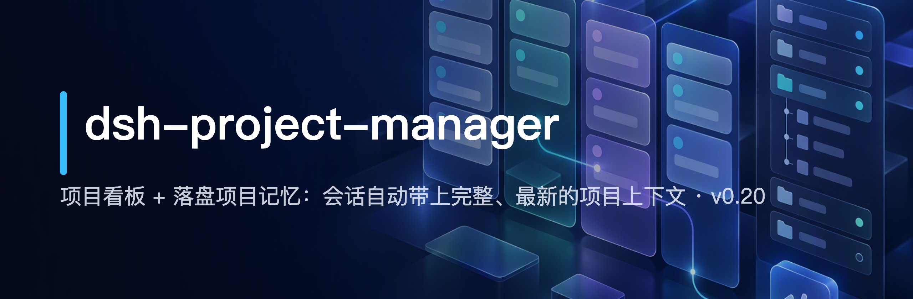

**A project board for DeepSeek Harness that treats project memory as a first-class job: every session opened from a card starts with the project's complete, up-to-date landfill memory (STATE + required sub-docs) and card details; say "落盘项目" and the progress is written back by the rules, so you can pick up the work in another session, another CLI, or days later.**

[**中文**](README.md) · [Releases](https://github.com/hoyyang/dsh-project-manager/releases) · [Changelog](CHANGELOG.md)

<p align="center">
  
  <a href="https://www.npmjs.com/package/dsh-project-manager"></a>
  <a href="https://www.npmjs.com/package/dsh-project-manager"></a>
  <a href="https://github.com/hoyyang/dsh-project-manager/releases"></a>
  <a href="LICENSE"></a>
  <a href="https://github.com/hoyyang/dsh-project-manager/stargazers"></a>
</p>

## Install

```sh
dsh plugin add dsh-project-manager
```

Alternative (straight from GitHub):

```sh
dsh plugin add github:hoyyang/dsh-project-manager
```

**Zero config, works out of the box**: restart dsh after installing. No account, API key or settings. Landfill memory lives in `~/.ai` by default (all writes go through the bundled `ai-memory`, which needs python3; on Windows this part is turned off and the board still works). See "Configuration" to change the data directory or permission mode.

| Environment | Version | Status |
|---|---|---|
| dsh CLI (`@deepseek-ai/dsh`, `dsh web`) | `0.2.0-rc.2` | Tested (0.20.0) |
| DSH Desktop | `2.0.17` (bundles dsh `0.2.0-rc.2`) | Tested (0.20.0) |
| peerDependencies | `@deepseek-ai/cordis >=4.0.1 <5`, `@deepseek-ai/dsh-tools >=0.1.5-rc <2`, `@deepseek-ai/dsh-client-ui-slots >=0.1.5-rc <2`, `@deepseek-ai/schemastery ^3.18.1` | Declared range; other versions in range not individually tested |

Needs the dsh web UI (`dsh web` or DSH Desktop). Sidebar enhancements (project hub counts, nesting, "+" takeover, blank-session rows) rely on the workspace list's page structure; if a dsh update changes it they simply stop showing, and the board, sessions and landfill keep working.

## What it does

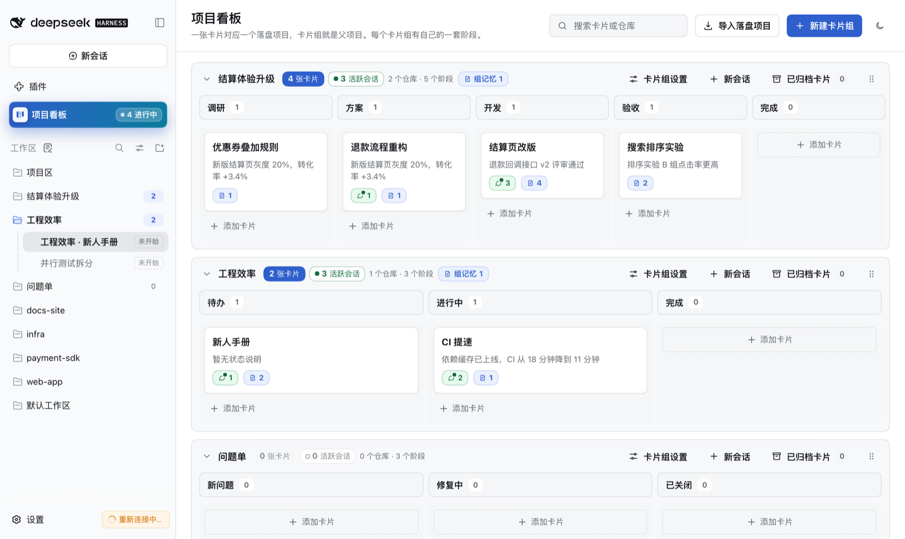

### Sessions start with the complete, latest project memory

- **Open a session from a card and the context is already there**: the plugin puts the **full text** of the card's landfill projects (STATE plus sub-docs tagged `[必读]`, "required") into the session, and the system prompt carries a live "card archive" (repos, subtasks, notes, links, files). No need to say "recall" first.
- **Always the latest, never duplicated**: when another session or another CLI (Codex, Claude Code, ...) changes the STATE, the next step gets the new version (marked with which version it replaces and who wrote it); after compaction the text is re-injected; each version goes in once, your own writes are not echoed back, forks inherit.
- **See exactly what the AI receives**: "查看 AI 收到的原文" in the session card shows the system prompt and injected text verbatim, with versions, whether it is already in this session, and an approximate token count.

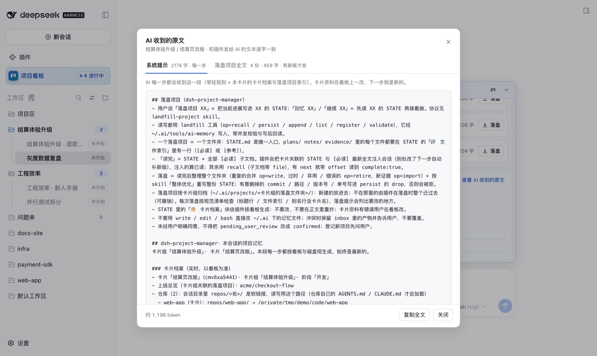

### Say "落盘项目" and progress is written back by the rules

- **One sentence**: "落盘项目 XX" writes progress into XX's STATE; "回忆 XX" / "继续 XX" reads it fully before continuing. Trigger words come from the project names and aliases already in `~/.ai`. Only command-style phrasing triggers, so talking about the feature does not; in plan mode it only reminds.
- **Facts are not lost**: no write without a full read; a draft that drops commit hashes, paths, versions or issue IDs without declaring them is rejected; every write is read back and reports size before/after and removed sections. If the user asked and the turn did not do it, the model is pulled back before the turn ends.
- **One project, one folder**: `STATE.md` is the single entry; every file in `plans/` (approved plans are saved here), `notes/` and `evidence/` has a line in the "📁 文件索引" (file index). Each persist rewrites the whole STATE and tidies the folder (merges duplicates, retires stale files to a recycle area).
- **Card archive inside STATE**: the plugin generates a "🗂 卡片档案" block from the board (the AI never writes it), so other tools reading the STATE see the card details too.
- **No bypassing**: direct `write` / `edit` / `bash` edits to memory files under `~/.ai` are refused; writes only go through `ai-memory` (file locks + optimistic concurrency), safe to share with other CLIs.

### Session card: which card this session belongs to, and what it carries


- **One line above the input box**: group / card, number of landfill projects, repo / link / subtask / note pills, and a jump to this card on the board. Light blue when linked, light grey when not.
- **Expand for everything**: one row per landfill project (project, aliases, next_action, injected or not, size) with its own "落盘" (persist) button; card details below.
- **Persist outcomes shown as they are**: after you persist from the card, the round ends with "落盘完成" (done) when written; if you stopped it, it failed, or the AI is asking you something, the card says so and offers "重新落盘 / 忽略" (retry / dismiss) instead of spinning forever.

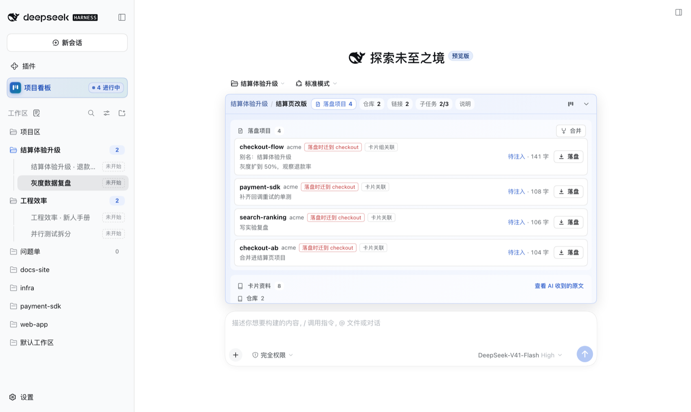

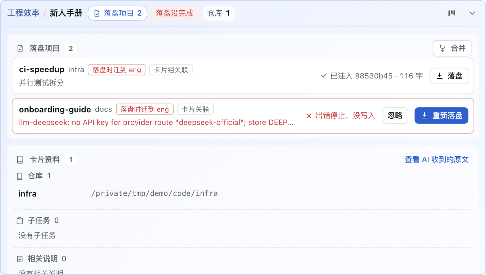

### Same-name detection: one project never becomes two

- **Hints before you type**: when the card has no landfill project, existing projects whose alias equals the card title are offered as "可能就是这个" (maybe this one).
- **Exact name match cannot be created again**: if the file name or an alias matches an existing project, the main button becomes "关联并落盘" (link and persist) with a rename suggestion; near matches are only hinted.
- **Each candidate is clear**: size, last update, which cards already link it, and whether persisting will move it; link only, or link and persist.

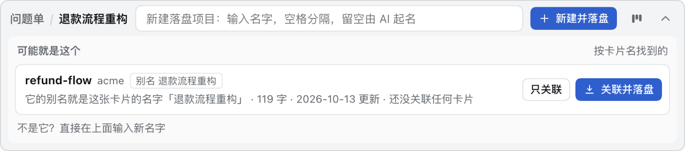

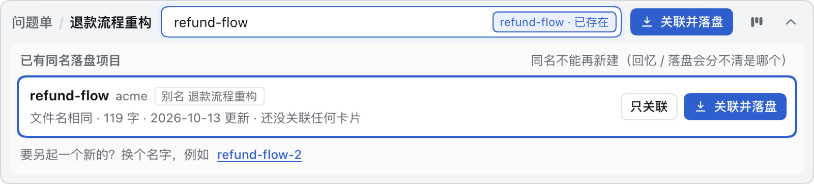

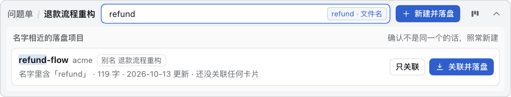

### Filed by card group, migrated by the rules

- **Each card group has its own landfill folder** `~/.ai/projects/<folder>/`. The first persist in a group asks you once to confirm a folder (suggested from the group name, editable); it can also be changed in group settings. New and merged landfill projects go there.
- **The spec is a versioned checklist** checked on every persist, so a STATE written under any older spec is brought up to date on its next persist. A project in the wrong place is moved **as a whole folder** by the plugin (sub-docs moved, old paths inside rewritten, references under `~/.ai` repointed, card links switched, old folder to the recycle area); the title line, file index and alias line are fixed by the persisting AI per the checklist, and a non-conforming draft is refused.
- **Told in advance, undoable afterwards**: the session card marks "落盘时迁到 xxx" (moves to xxx on persist) beforehand; afterwards an "已按规范迁移" card lets you undo (move back, no more auto-moves) or delete the old folder. Projects shared by several groups stay with the first one linking them; nothing is migrated in bulk, only on persist.

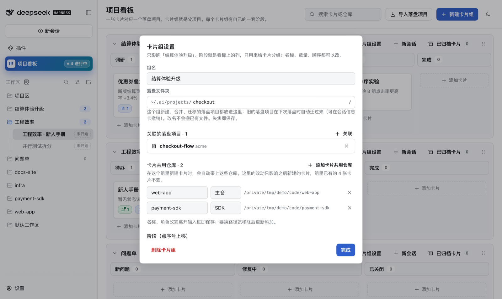

### Merge landfill projects

- **Several into one**: projects linked to the same card can be merged (pick which). The AI reads each in full, writes key points first, then rewrites one STATE; the plugin checks key facts from every source survive, then files everything into the merged folder by the rules (identical files once, files outside `~/.ai` copied into `evidence/`).
- **Old names become aliases**: "recall + old name" still works; card links and references under `~/.ai` are updated.
- **Undo, delete, nest**: sources go to the recycle area; undo one step or delete permanently; merged results can be merged again.

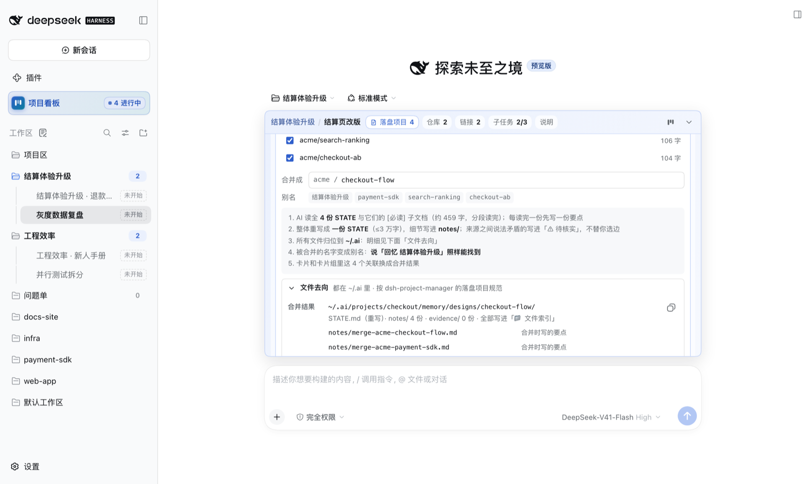

### Board: groups are parent projects, cards are tasks

- **See everything by project**: one lane per group; stages (columns) can be renamed, added, reordered; drag cards within a stage (Alt+↑/↓) or to another stage to advance; groups can be dragged and collapsed.
- **Group header stats**: card count in a blue pill (grey at 0) and "● N active sessions" (sessions of this group's cards that are not archived, live); repo and stage counts in small grey text.
- **Add cards anywhere**: every stage has an "add card" box (Enter to keep adding); or import from landfill projects in bulk.
- **Two small badges per card**: session badge (green with active sessions, grey when all archived) and landfill count.
- **Card archive**: archive icon or drag into "archived cards"; read-only detail, "restore" returns it to its stage.
- **The agent can edit the board too**: `card_manage` / `repo_manage` / `phase_move` / `task_manage`; without `card` they act on the session's card.
- **Dark theme**: follows dsh, one-click toggle on the board.

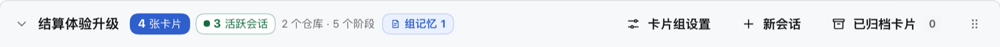

### Card detail

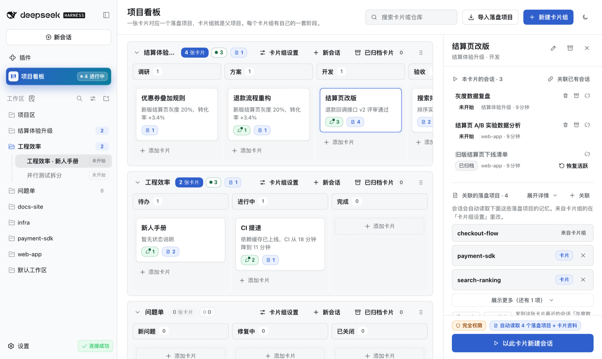

- **New session from this card**: the button switches to "正在新建会话…" (creating) and locks at once, a placeholder row appears in the sidebar, and the finished row reads "card title · not started". Sessions default to full access and are titled after the card.
- **This card's sessions on top**: active first, archived after, each by update time; open, archive (confirm "stop and archive" when running, undoable), restore to the original place, unlink; sessions with no conversation yet can be deleted (needs [dsh-manage-sessions](https://github.com/hoyyang/dsh-manage-sessions)).
- **Link existing sessions**: search by name or repo, active / archived columns grouped by repo, save in one go; a session belongs to one card, forks follow their source.
- **Linked landfill projects**: titles by default, "展开详情" expands all (project, date, status, next_action); "回忆" / "落盘" buttons send to the card's latest session.
- **Notes / links / files**: unlimited notes with clickable URLs and folding; links with text, type (global, add/rename/reorder in "管理类型") and URL, bulk add, always-visible edit / delete, drag to reorder, copy; files via the system picker or "paste paths" (each line checked: exists / folder / missing / already linked).
- **Stages and subtasks**: click the stepper to move stage; tick, delete, add subtasks.

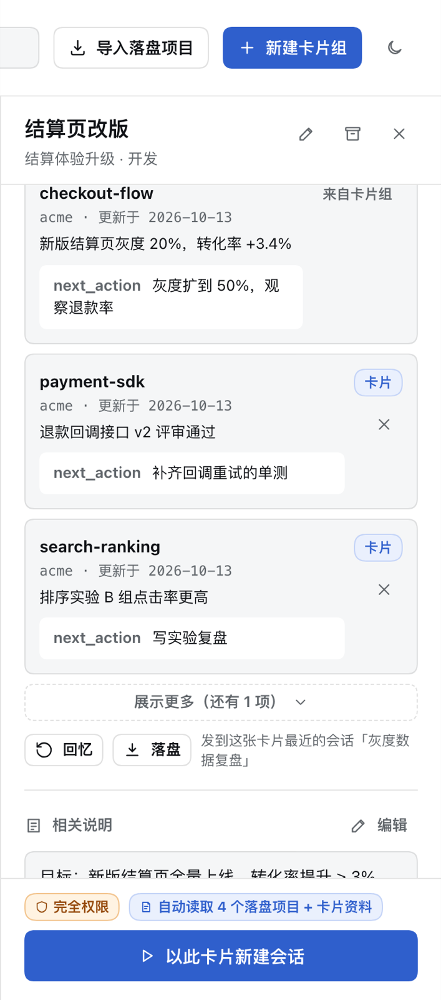

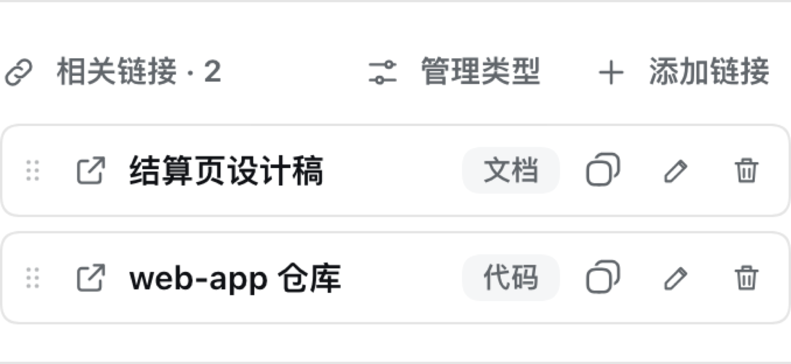

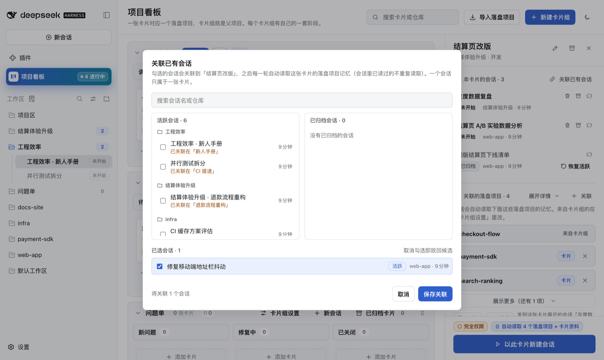

### Repos

- **Shared repos + card repos**: repos in group settings are shared by cards (copied into new cards); cards can add their own. Candidates come from dsh workspaces and repos added anywhere, or "选择文件夹…".
- **One path in project sessions**: repos are symlinked under `repos/<repo>/` in the session directory with an AGENTS.md listing them; reading through that path loads the repo's own AGENTS.md / CLAUDE.md. Same name, different path becomes "name-2".

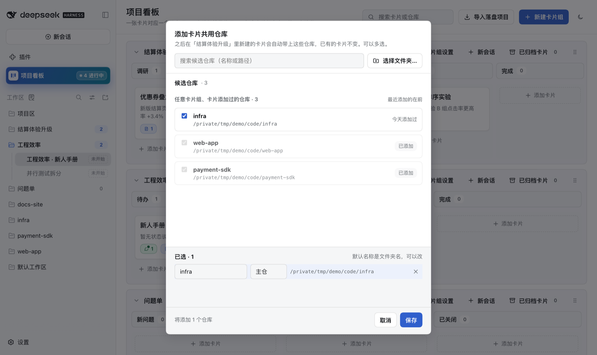

### Sidebar "项目区" (project hub)

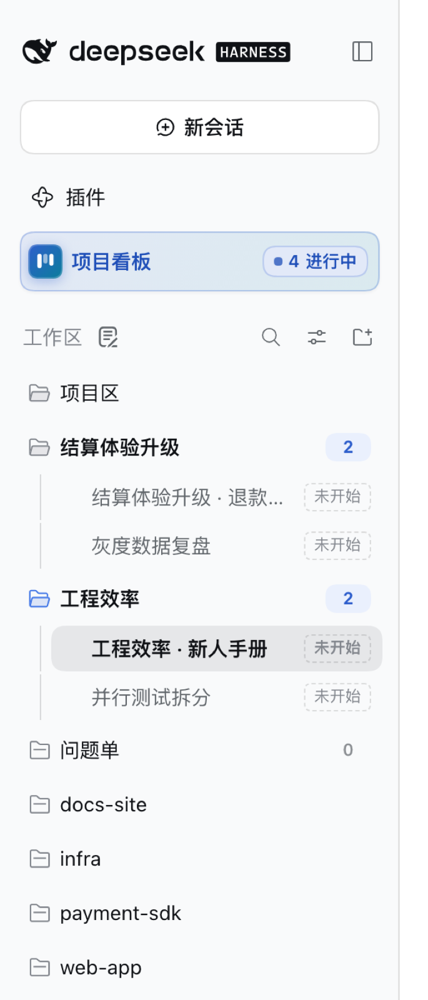

- **Project hub workspace** pinned on top, each group a child workspace (nested with "group by workspace tree"); project sessions live here.
- **Active counts + nesting**: each group row shows unarchived sessions (grey at 0, bumps on change); sessions are indented behind a guide line.
- **Blank sessions show up too**: dsh hides sessions with no conversation; the plugin draws them as "card title · not started" rows (including the one you have open), deletable in place.
- **Auto-expand from the board**: opening or creating a session from the board expands its collapsed group and scrolls to it.
- **"+" picks a card first**: the hub or group "+" opens a card picker (stage, memory count, session count), then a new or existing session.
- **"项目看板" button** next to "Plugins", with an "N in progress" badge (unarchived cards with at least one unarchived session).

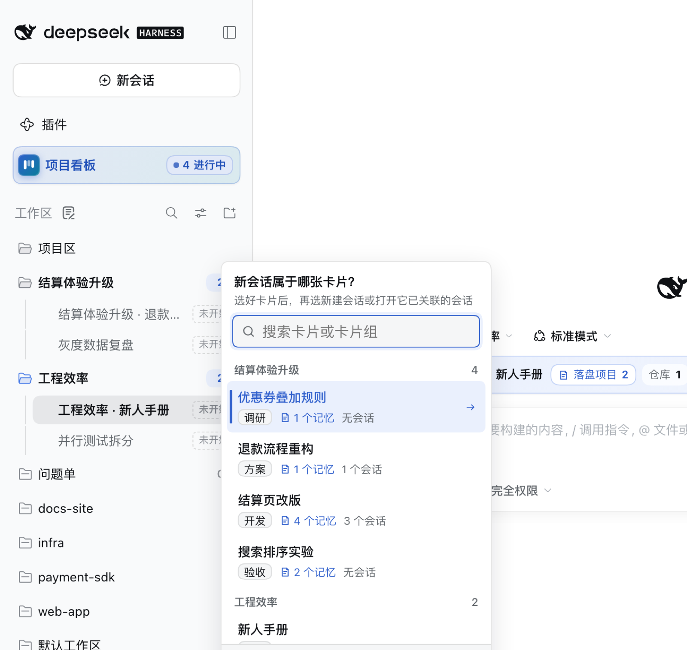

**How it differs**: most board plugins track to-dos per workspace. This one only does the chain "project → landfill memory → repos → sessions", and builds reading, writing, spec, migration and merging of that memory into the plugin: a card is a project, and its sessions inherit the complete, latest project context.

## Quick start (30 seconds)

1. Click "项目看板" under "Plugins" in the sidebar, then "新建卡片组" (new group), type a name, Enter.
2. Click "添加卡片" (add card) at the bottom of any stage, type a title, Enter.
3. Open group settings, add repos under "卡片共用仓库"; set the "落盘文件夹" (landfill folder) if you like.
4. In card detail click "以此卡片新建会话": the session appears under this group in the project hub, with card details attached.
5. After some work, say "落盘项目" (or click "新建并落盘" in the session card); the next session from this card has the memory automatically.

| Action | Result |
|---|---|
| New session from card | Button shows "creating" immediately; sidebar row "card title · not started"; group count +1 |
| Say "落盘项目" in the session | STATE written into the group's landfill folder with the card archive block, read back, card says "done" |
| Click "Stop" mid-persist | Card shows "stopped, nothing written" with retry / dismiss |
| Type an existing project's name in the card | Button becomes "link and persist", tag says "exists", rename suggested |
| Persist a project in an old location | Whole folder moves to the group's folder, "migrated" card appears, undoable |
| Another CLI changes the STATE | Next step receives the new full text, marked with the replaced version and writer |
| Draft drops a commit hash from the old STATE | Rejected (`DROPPED_ANCHORS`) naming what is missing |
| Drag a card to another stage | Card moves; `events.jsonl` gets a move record |

Let the agent drive the board (without `card` it acts on the session's card):

```text
> Move this card to "验收" and add a subtask "补回归用例"
phase_move  { "status": "verify" }                     → {"ok":true,"event":{"kind":"move","from":"开发","to":"验收"}}
task_manage { "op": "add", "text": "补回归用例" }      → {"ok":true,"tasks":[…,{"text":"补回归用例","done":false}]}
```

Read and write landfill projects (the `landfill` tool the plugin registers; the model calls it per the bundled skill):

```text
landfill { "op": "recall" }                          → STATE + [必读] in chunks until complete:true
landfill { "op": "persist", "content": "…", "drop": ["a1b2c3d"] } → {"key":"checkout/checkout-flow","verified":true,"migrated":{…}}
```

## Use cases

- **Long-running projects**: persist today, open a new session from the card tomorrow; status, decisions and next_action are already in context.
- **One memory across CLIs**: persist in DSH, Codex / Claude Code read the same STATE in `~/.ai`; when they write, DSH picks up the new version on the next step.
- **One feature across several repos**: mount frontend, SDK and infra repos on a group; read and write them via `repos/<repo>/` in project sessions.
- **Clean up scattered memory**: merge duplicates into one with old names as aliases; misplaced projects move into the group's folder on the next persist.
- **Gather scattered sessions**: link earlier discussions to the same card.
- **Start the day with the big picture**: card and active-session counts per group, session badges per card.
- **Hand-offs**: a card's landfill projects, notes, links, files and sessions are the hand-off list.
- **Let the agent advance work**: the agent moves stages and ticks subtasks; every change is audited.
- **One card per ticket**: title the card with the ticket ID and the landfill project gets it as an alias; "recall + ticket ID" in any session finds the analysis again.
- **Spec upgrades without manual migration**: STATEs written under older specs need no bulk cleanup; whichever project is persisted next moves into the group folder and gets the missing spec items.

## What you'll see

- Sessions from a card carry the STATE and `[必读]` full text from the first step; the system prompt has one "project memory" section (card archive + landfill index).
- After persisting, STATE lives at `~/.ai/projects/<group folder>/memory/designs/<name>/STATE.md` with the card archive block, file index and alias line.
- The session card shows each persist round's outcome live; same-name candidates appear as you type.
- Each group row under the project hub shows its active-session count; new blank sessions show the card title.
- Every move, link, mount and migration is appended to `events.jsonl` (who, when, what).
- After a merge, the merged folder holds STATE.md, notes/ (key points from each source) and evidence/; the sources sit in each project's `inbox/retired/`.
- After a migration, the old folder sits in `inbox/retired/<time>-migrate-<name>/` of the old project; the session card shows how many sub-docs moved and references changed.
- "查看 AI 收到的原文" shows the system-prompt length, number and total size of injected texts, and approximate tokens.

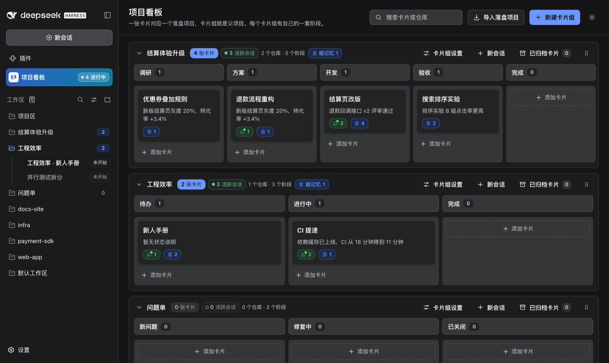

## Configuration

Works with zero config. To override, add a top-level id entry to the profile's `cordis.patch.yml` (not inside the `insert:` list):

```yaml
- id: dsh-project-manager
  config:
    dataDir: ''                              # default <DSH_HOME>/dsh-project-manager
    aiRoot: ''                               # default ~/.ai
    landfill: true                           # landfill tool / detection / guard / end-of-turn check (false = read-only scan)
    agentsHome: ''                           # ~/.agents holding the landfill-project skill link
    hubTitle: 项目区
    projectSessionMode: danger-full-access   # or inherit (follow global permission)
    memoryMaxBytes: 6000                     # cap of the project-memory section in the system prompt, 1000–32000
```

Each group's landfill folder is set in group settings, not in config.

## How it works

- **Data**: the board is `<dataDir>/board.json` (atomic writes, serialized mutations), audit in `events.jsonl`; landfill projects are scanned from `~/.ai/projects/*/memory/designs/*/STATE.md`; writes only via `~/.ai/tools/ai-memory` (Python stdlib: fcntl locks + expected-hash + journal). Merge and migration records in `merges.json` / `migrations.json`.
- **Injection**: one system-prompt section (card archive regenerated each step + landfill index); STATE and `[必读]` full text injected at `agent/pre-step` as one-off messages, tracked per session × file version across restarts, re-injected after compaction events.
- **Persist triggers**: `agent/pre-step` detects the user's words and adds a hint; `tools/pre-execute` blocks direct writes; `agent/turn-stopping` checks and steers back; the `turn/end` reason (completed / aborted / error) drives the session card's persist state.
- **Spec and migration**: the checklist (v2: location, title line, file index, alias line with card titles) runs before every persist; location is fixed by moving the folder with `ai-memory retire-dir / write / import / update-state`, rolled back step by step on failure.
- **Project hub**: the official `workspaceRegistry` registers the hub (`<dataDir>/hub`) and a child workspace per group; repos are symlinked under `repos/<repo>`.
- **UI**: the board is a main-area panel; the board button uses the official `sidebar.panellist`; the session card uses `conversation.input.dock`; sidebar counts and nesting are a stylesheet keyed by row id, while "+" takeover, blank rows and auto-expand are DOM enhancements that quietly skip when rows are not found.

## Reliability & verification

- **Isolated verification**: each version is assembled in a separate staging DSH_HOME; cold-start static checks (link deps / bundle manifest / runtime imports / duplicate entries, six classes) must pass for this plugin before it reaches the main instance.
- **End-to-end with a real model**: 0.20 ran "persist → auto-migrate → spec check → migration card → undo" and "new project lands in the group folder" in staging; 0.19 ran merge, nested merge, child delete and byte-exact undo on 6 copies of real landfill projects.
- **Real GUI tests**: Playwright on real dsh web: group stats, creating state and sidebar title, always-visible link buttons, arrow direction, the three same-name cases, group-folder confirmation and invalid names, stopped state and dismiss, no page shift — all pass, 0 page errors.
- **Main-instance acceptance**: after installing into the daily dsh, probes confirm the new logic runs (0.20: group stats, creating state and "card title · not started", link buttons, arrow, same-name detection).
- **Unit tests**: 95 node:test cases (board model, injection and known-version tracking, persist guards, merge end-to-end, spec checklist, same-name matching, migration and undo, persist-round tracking) + 9 ai-memory tests.
- **Failures name the culprit**: `NEED_FULL_READ`, `DROPPED_ANCHORS`, `UNINDEXED_FILES`, `SPEC_ISSUES`, `NEED_GROUP_FOLDER`, `MIGRATE_CLASH`, `FOLDER_TAKEN`, `REPO_MOUNTED` and more; nothing is swallowed.
- **Compatibility & limits**: restore and blank-session delete depend on dsh-manage-sessions (greyed out or hidden without it); landfill needs python3 (off on Windows); multiple dsh processes sharing one DSH_HOME have no cross-process board lock (`~/.ai` writes do).
- **Security boundary**: project sessions default to full access (only sessions in the hub directory; switch to `inherit`); HTTP routes accept loopback only (Host must be 127.0.0.1 / localhost); writes carrying an Origin must be same-origin (DSH Desktop strips Origin when forwarding, which is allowed), no login check; the plugin writes `~/.ai` and creates the `~/.agents/skills/landfill-project` link; it never touches credentials, the network or git; deleting a group removes symlinks only.

## FAQ

- **No "项目区" in the sidebar?** It is registered with the first project session; use the "项目看板" button until then.
- **Groups not nested under the hub?** Set grouping to "by workspace tree" in the workspace list's view options.
- **Why am I asked for a landfill folder?** New and migrated projects go into the group's own folder; asked once, changeable in group settings.
- **Will my old landfill projects be moved?** Only when you persist them and their group has a folder set; undo from the session card stops future auto-moves.
- **Persist refused?** Read the error code: recall first if not fully read; restore missing facts or list them in `drop`; for `SPEC_ISSUES` fix the listed items.
- **"Restore" greyed out?** Your dsh lacks `workspaceRegistry.unarchiveSession`; install dsh-manage-sessions and apply its core patch.
- **"选择文件夹…" became a text box?** With the web file browser (non-local or remote access) the system dialog is unavailable; type an absolute path.

## Uninstall

1. Call `POST /_dsh/dsh-project-manager/api/hub/cleanup` (or remove the hub and group workspaces manually) to drop the workspace entries; sessions and files are kept.
2. `dsh plugin --profile web remove dsh-project-manager`, restart dsh.
3. Data stays in `<DSH_HOME>/dsh-project-manager/` (board.json, events.jsonl, merges.json, migrations.json, hub/, backups/); delete manually if needed.
4. Landfill: `~/.ai` (including the `tools/ai-memory` the plugin may have added) is shared memory and is not removed. If `~/.agents/skills/landfill-project/SKILL.md` is a link to the plugin it breaks after uninstalling; copy the backup in `backups/` (or the plugin's SKILL.md) back to keep the skill.

## Build locally

```sh
npm install
npm run build          # host: tsc → lib/
npm run build:client   # client: tsdown → lib/client.js
npm run typecheck
npm test               # node:test + ai-memory tests
```

## License

[MIT](LICENSE)
