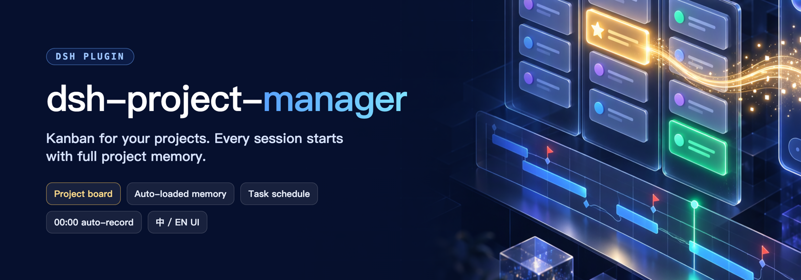
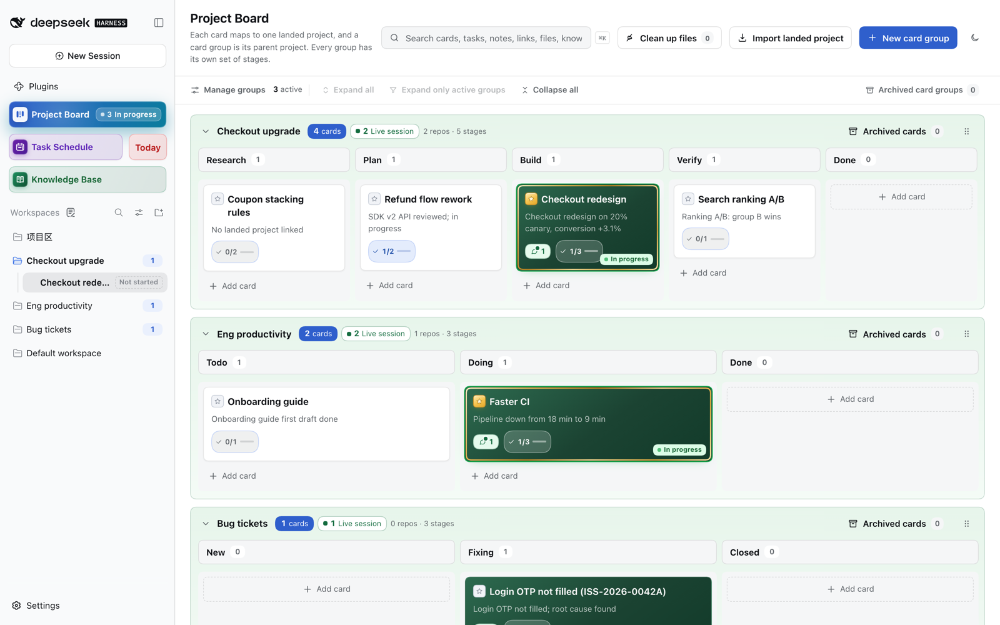
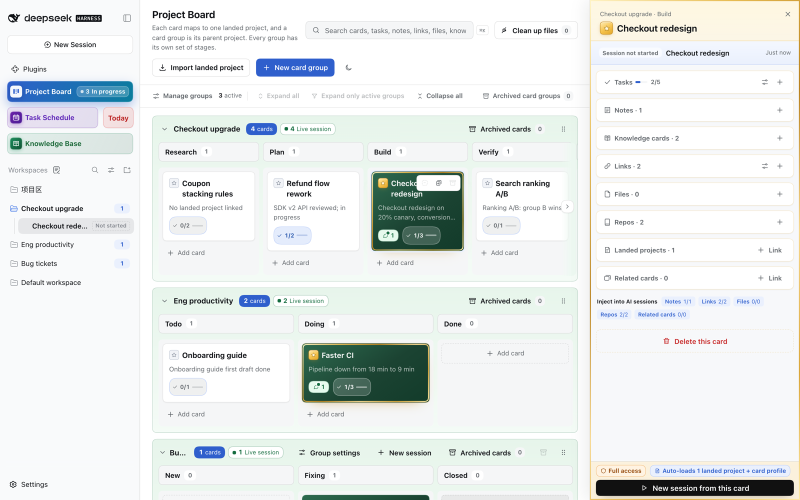
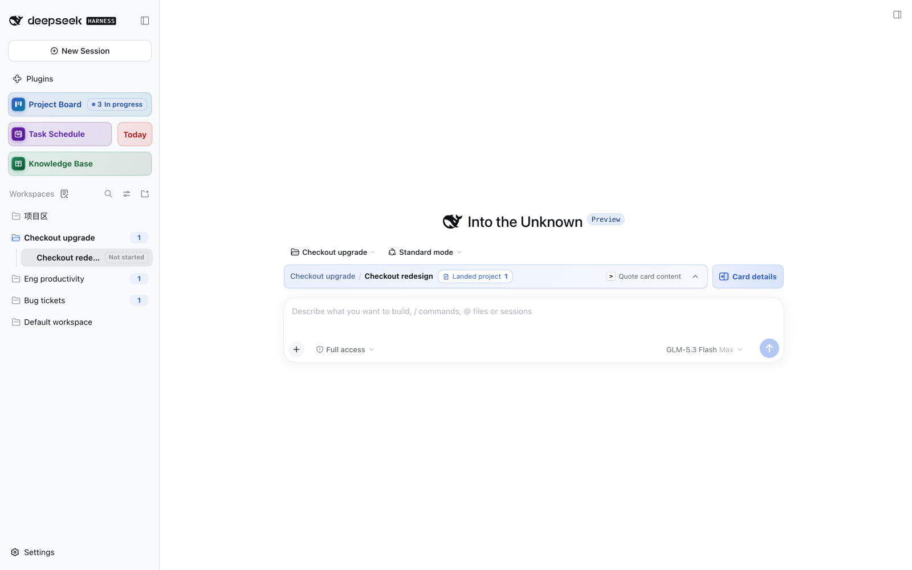
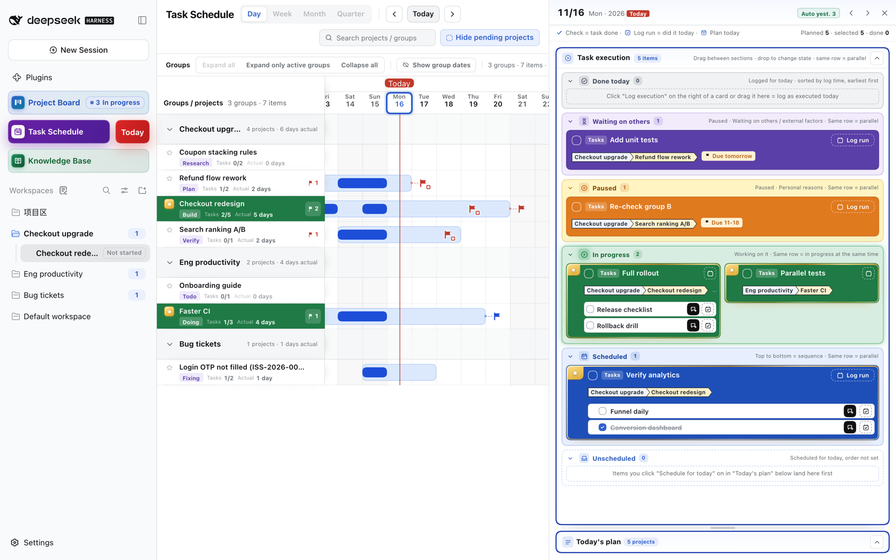
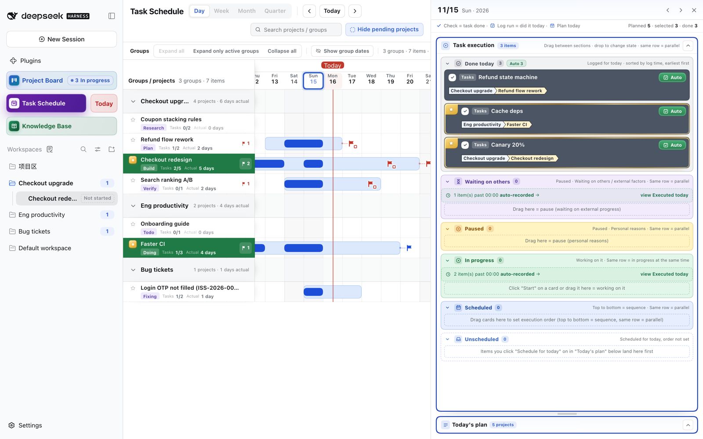
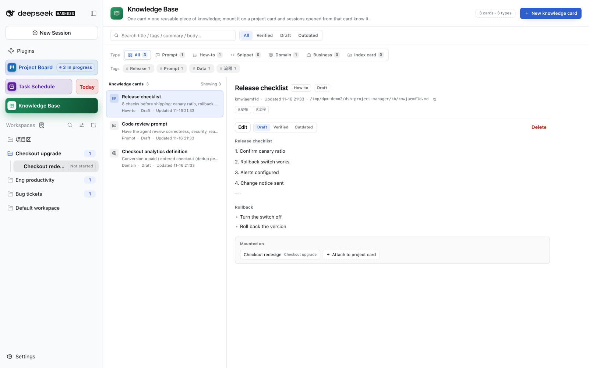

<div align="center">



# dsh-project-manager

**Project board and persistent project memory for DeepSeek Harness. Open a session from a card and the AI starts with full project state on turn one.**

<a href="https://www.npmjs.com/package/dsh-project-manager"></a>
<a href="https://www.npmjs.com/package/dsh-project-manager"></a>
<a href="https://github.com/hoyyang/dsh-project-manager/releases"></a>
<a href="https://github.com/hoyyang/dsh-project-manager/stargazers"></a>
<a href="LICENSE"></a>

[简体中文](README.md) · **English** · [Releases](https://github.com/hoyyang/dsh-project-manager/releases) · [Changelog](CHANGELOG.md) · [Issues](https://github.com/hoyyang/dsh-project-manager/issues)

</div>

## Install

```sh
dsh plugin add dsh-project-manager
```

Alternative: `dsh plugin add github:hoyyang/dsh-project-manager`. Restart dsh after installing. Zero config, no account, no API key required.

> Requires the dsh web UI (`dsh web` or DSH Desktop). Tested on dsh `0.2.0-rc.2`. Project memory requires `python3` (on Windows, only project memory is disabled).

## Highlights

| | Feature | Summary |
|---|---|---|
| 🗂 | **Project board** | Card group = parent project, card = project; one search box covers titles and everything inside cards |
| 🧠 | **Auto-loaded project memory** | Sessions opened from a card receive full `STATE.md` and must-read docs automatically, syncing updates across CLIs |
| 🛡 | **Guarded memory writes** | Rejects writes without a full read first or when commits, paths, or versions disappear undeclared (`DROPPED_ANCHORS`) |
| 📅 | **Schedule + Today panel** | Plan, actual and deadlines on one timeline; after 00:00, yesterday's in-flight work is logged automatically |
| ⚡ | **Task ↔ session sync** | When a linked session starts running, the task moves to **In progress** |
| 📚 | **Knowledge base + EN/中文 UI** | Reusable knowledge cards attached to projects; switch UI language instantly |

## Features

### Project board



- **Swimlane groups**: Each card group is a swimlane with customizable stages (rename or reorder); drag cards across stages to track progress.
- **Live activity indicators**: Cards display session counts and task progress; cards with an active session glow green.
- **Starred projects**: Star any card to show a gold badge across the board, detail drawer, Gantt schedule, and Today panel.
- **Deep search**: One query searches card titles and inner content (tasks, subtasks, notes, links, files, attached knowledge cards) with hit snippets that jump straight to the matching item.



- **Card details**: tasks, notes, knowledge cards, links, files, repos and the linked landed project in one drawer; each item can be switched in or out of session injection.

### Sessions start with project memory



- **Full-text injection**: Sessions started from a card automatically receive the full linked `STATE.md` and its `[必读]` (must-read) sub-documents on the first turn.
- **Cross-CLI version tracking**: If another session or external CLI (Codex / Claude Code) edits `STATE.md`, the next turn in your session receives the updated version (each version is sent once).
- **Info bar**: above the input — shows the card and landed project; **Quote card content** drops tasks, notes or knowledge cards into the chat; you can view the raw text the AI received.
- **One-line persist & recall**: say `落盘项目 <name>` (persist) to write progress back, `回忆 <name>` / `继续 <name>` (recall / continue) to read it all and pick up. The trigger words are Chinese by design.
- **Write-back guards**: All writes go through the bundled `ai-memory` tool (file locks + optimistic concurrency). The AI must read the full state before writing; if a new draft drops commit IDs, file paths, or version numbers without declaring them, the write is rejected with `DROPPED_ANCHORS`.
- **Housekeeping**: merge duplicate landed projects, archive by card group — all undoable.

### Task Schedule and Today panel



- **Unified timeline**: View planned dates (light blue), actual active days (dark blue, recorded automatically on days with conversation), and deadline flags (red) on one Gantt chart.
- **Today panel**: zones **Waiting on others / Paused / In progress / Scheduled / Unscheduled**; drag to change state. **Plan today** sends a task straight to Scheduled.
- **Tasks follow sessions**: a task can link several sessions (one active). When a linked session starts running, the task or subtask moves to **In progress** right away.



- **Auto-log at 00:00 (new in 0.79)**: cards still in Waiting on others / Paused / In progress when the day ends are logged as run for that day (not marked done). A badge next to today jumps to yesterday; click **Auto** on a card to undo that batch — it won't be re-added.

### Knowledge base, language and file cleanup



- **Knowledge cards**: prompts, how-tos, snippets, domain and business knowledge, summary cards — with tags and search.
- **Attach or quote**: attach a knowledge card to a project and its sessions see it; or quote a whole card, or just one section split by a titled divider.
- **Interface language**: Settings → Project Board → Interface language: Follow DSH / 中文 / English. Instant, no reload; your own content is never translated.
- **Clean up files**: lists files linked from cards in landed projects, grouped by card; filters for useless / tasks all done / archived / in use / missing. Delete goes to the Trash and can be undone.

## Quick start

1. Click **Project Board** in the sidebar, then **New card group** and **Add card**.
2. Open the card drawer to add tasks, notes, or repositories.
3. Click **New session from this card**.
4. Open **Task Schedule** → **Today** and drag tasks into zones.
5. At a milestone, type `落盘项目` in the session to persist.

| Action | Result |
|---|---|
| Click **New session from this card** | Session shows up under the sidebar **Project area**, with card material and `STATE.md` already loaded |
| Persist project state in chat | Validated and written to `~/.ai` via `ai-memory`; rejected with `DROPPED_ANCHORS` if key facts were omitted |
| Another CLI updates `STATE.md` | The next turn in your active session automatically receives the new version |
| A session linked to a task starts running | The task moves to **In progress** in the Today panel |
| The clock passes `00:00` | Yesterday's in-flight tasks are logged as run; a badge next to today links to them |

Inside a project session, the agent can drive the board (no `card` = this session's card):

```text
phase_move  {"status":"verify"}
task_manage {"op":"add","text":"Add regression tests"}
landfill    {"op":"recall"}
```

`card_manage` and `kb_manage` are also available.

## Use cases

- **Long-running projects**: persist today, open a new session tomorrow and pick up where you left off.
- **Multi-repo work**: one card mounts front-end, SDK and infra repos; the session sees all of them.
- **One memory across CLIs**: DSH, Codex and Claude Code read and write the same `~/.ai`.
- **Daily stand-up**: the Today panel shows what each project is doing and what got done yesterday.
- **Bug tickets**: one card per ticket; recall by ticket ID to get the analysis back.
- **Handover**: the card's memory, notes, links and sessions are the handover list.
- **Tidy scattered memory**: several copies of the same project merge into one; old names become aliases.
- **Let the agent drive**: ask the agent to move stages or add tasks; the board updates live.

## Good fit / not a fit

- **Good fit**: Multi-day projects you return to repeatedly, multi-repo work, sharing project memory between DSH and other CLIs, and daily stand-up reviews.
- **Not a fit**: Simple standalone todo lists, or real-time multi-user collaboration (all data stays on your machine).

## Results

- Sessions opened from a card get `STATE.md` and the must-read docs on step one.
- Persisted STATE lands at `~/.ai/projects/<group folder>/memory/designs/<name>/STATE.md`.
- Every move, link and migration is appended to `events.jsonl`.
- The sidebar **Project area** groups project sessions by card group, with live counts.
- After 00:00, yesterday's in-flight tasks show up in **Done today** with an **Auto** tag.
- Merged folders go to `inbox/retired/` and can be restored.

## Comparison

| | dsh-project-manager | Generic kanban / todo plugins | Memory-only plugins |
|---|:---:|:---:|:---:|
| Project board + custom stages | ✅ | ✅ | — |
| Auto-inject project memory into sessions | ✅ Full text + version tracking | — | Retrieval only |
| Write-back guards against dropped facts | ✅ | — | — |
| Shared `~/.ai` across CLIs | ✅ | — | — |
| Task ↔ session status sync | ✅ | — | — |
| Daily schedule + auto day close | ✅ | — | — |
| Multi-user / cloud sync | — | Depends | Depends |

## How it works

- **Two local stores**: the board lives in `<DSH_HOME>/dsh-project-manager/`; project memory lives in `~/.ai`, shared with other CLIs.
- **Versioned injection**: the first step gets card material + `STATE.md` + must-read docs; when a file changes, the next step gets the new version.
- **One write path**: memory is written only through the bundled `ai-memory` — full read first, file lock, optimistic concurrency, anchor check.
- **Host-side settlement**: session state drives task zones; the 00:00 close runs in the host, once per day.

## Reliability

- **Tested twice**: every release is click-tested in an isolated staging `DSH_HOME`, then on a real instance; cold-start static checks must pass.
- **Tests**: 596 unit tests + 9 `ai-memory` tests.
- **Fails loudly**: error codes like `NEED_FULL_READ`, `DROPPED_ANCHORS`, `SPEC_ISSUES` name the cause.
- **Safe by default**: loopback-only routes; no credential reads, no network calls, no git; deleting a card group only removes symlinks.
- **Degrades quietly**: if a dsh update changes the page structure, sidebar add-ons hide themselves; data is untouched.
- **Undoable**: file deletes go to the Trash; merges and the 00:00 auto-log can be undone.
- **Known limits**: data stays on this machine (no multi-user sync); persisting is unavailable on Windows (needs `python3`).

## FAQ

**There is no "Project area" in the sidebar.**
It appears after your first project session. Until then, use the **Project Board** entry.

**How do I see what the AI received?**
In the info bar above the input, click **View the raw text the AI received**.

**My persist was rejected.**
Follow the error code: recall the full state first (`NEED_FULL_READ`), or list intentional removals in `drop` (`DROPPED_ANCHORS`).

**Why were yesterday's tasks logged automatically?**
That's the 0.79 auto-log at 00:00. Jump to yesterday and click **Auto** on a card to undo the batch; it won't come back.

**How do I switch the UI to English?**
Settings → Project Board → Interface language → English.

**"Restore" is greyed out.**
Install [dsh-manage-sessions](https://github.com/hoyyang/dsh-manage-sessions).

## Configuration

Zero config by default. To customize, add a top-level entry to your profile's `cordis.patch.yml`:

```yaml
- id: dsh-project-manager
  config:
    aiRoot: ''                              # memory directory, defaults to ~/.ai
    landfill: true                          # false = board only
    projectSessionMode: danger-full-access  # or inherit
```

## Uninstall

```sh
dsh plugin --profile web remove dsh-project-manager
```

Uninstall keeps both `<DSH_HOME>/dsh-project-manager/` and `~/.ai` intact.

## Local development

```sh
npm install && npm run build && npm run build:client && npm test
```

## License

[MIT](LICENSE) © hoyyang