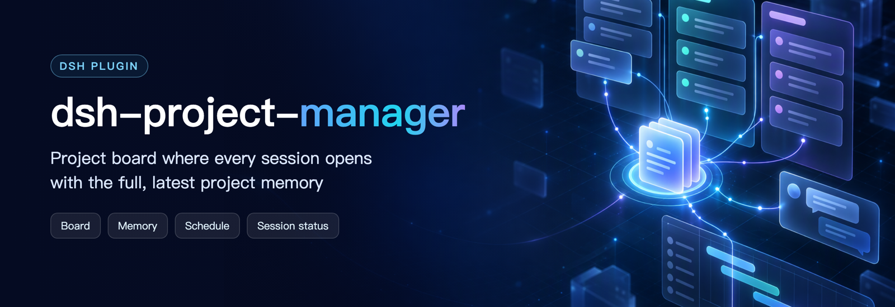
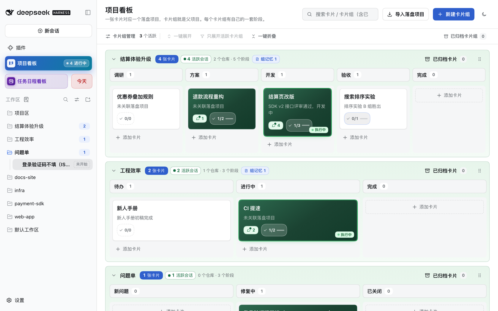
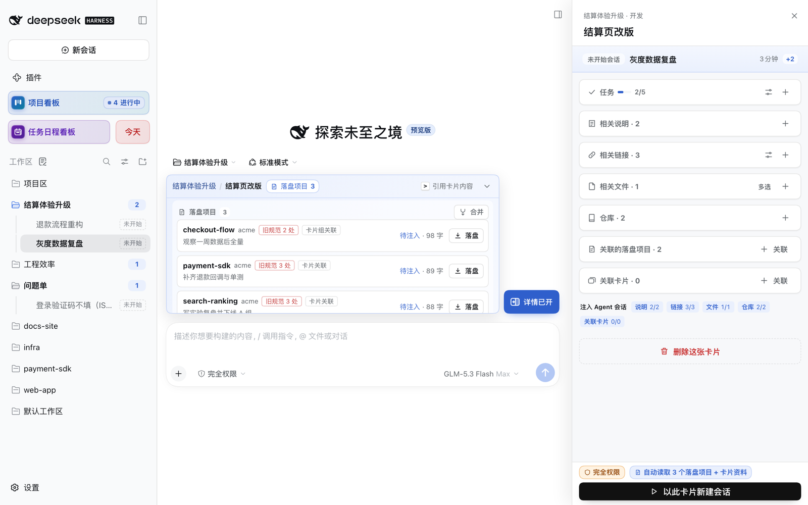
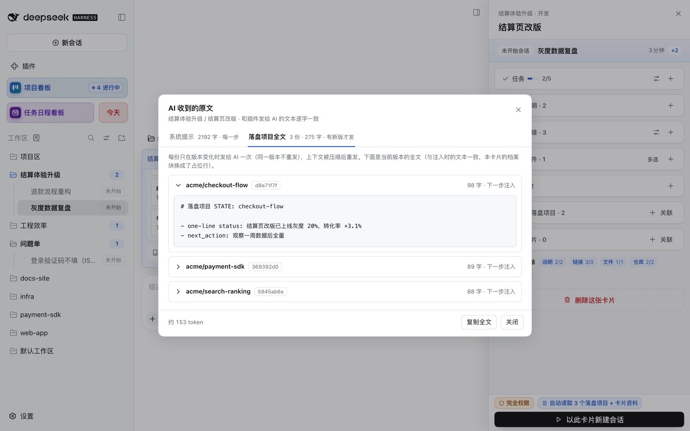
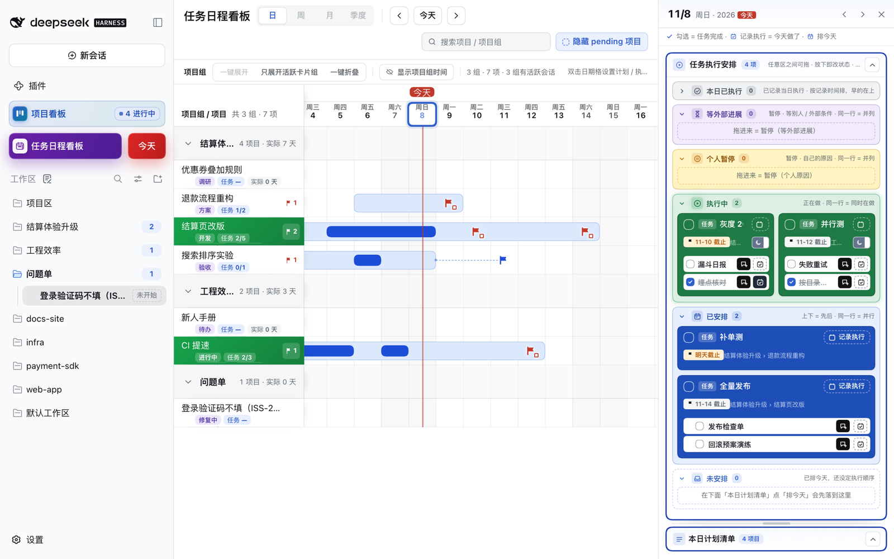
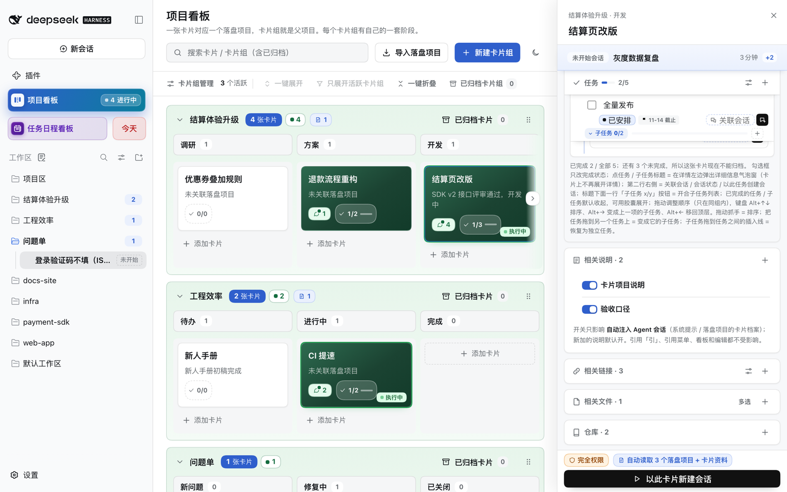
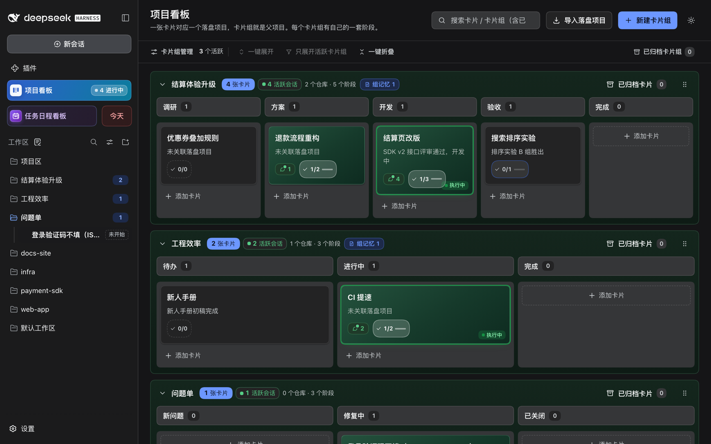

<div align="center">



# dsh-project-manager

**Project board + project memory for DeepSeek Harness. Open a session from a card and the AI already knows where the project stands.**

<a href="https://www.npmjs.com/package/dsh-project-manager"></a>
<a href="https://www.npmjs.com/package/dsh-project-manager"></a>
<a href="https://github.com/hoyyang/dsh-project-manager/releases"></a>
<a href="https://github.com/hoyyang/dsh-project-manager/stargazers"></a>
<a href="LICENSE"></a>

[简体中文](README.md) · **English** · [Changelog](CHANGELOG.md) · [Issues](https://github.com/hoyyang/dsh-project-manager/issues)

</div>

## Install

```sh
dsh plugin add dsh-project-manager
```

Or `dsh plugin add github:hoyyang/dsh-project-manager`. Restart dsh. **Zero config**, no account or API key.

> Needs the dsh web UI (`dsh web` or DSH Desktop). Tested on dsh `0.2.0-rc.2` and DSH Desktop `2.0.18`. Project memory needs `python3`; on Windows only that part is off. The UI is in Chinese; screenshots are the real UI.

## Features

| | Feature | In one line |
|---|---|---|
| 🗂 | **Project board** | Groups = parent projects, cards = projects, custom stages, drag to advance |
| 🧠 | **Sessions load memory** | Sessions opened from a card get the full project STATE, refreshed when it changes |
| 💾 | **One-phrase persist** | Say "persist project" to write progress back; dropping key facts is refused |
| 📅 | **Schedule + Today panel** | Plan / actual / deadline on one timeline; today's tasks grouped by state |
| 🔗 | **Task ↔ session sync** | When a linked session runs, the task moves to "running" |

### Project board



- **Grouped by project**: one lane per group; rename, add, and reorder stages.
- **Status at a glance**: cards show session count and task progress; running cards glow green.
- **Dark mode**: follows dsh, one-click toggle.

### Sessions open with project memory



- **Full-text injection**: the card's `STATE.md` and `[必读]` (must-read) docs go into the session whole, no "recall" step.
- **Always current**: if another session, Codex, or Claude Code edits STATE, the next step gets the new version; each version is sent once.
- **Info card**: above the input, shows which card this session belongs to and which memories it carries.
- **Inspectable**: view exactly what the AI received, with a token estimate.



### Persist in one phrase, without losing facts

- **Trigger words**: "落盘项目 XX" (persist) writes progress; "回忆 XX" / "继续 XX" (recall / continue) reads everything first.
- **Fact guard**: no write without a full read; a draft that drops old commits, paths, or versions without declaring it is refused.
- **Concurrency-safe**: writes go only through the bundled `ai-memory` (file lock + optimistic concurrency); direct edits to `~/.ai` are blocked.
- **Housekeeping**: same-name detection, merging, and per-group filing, all undoable.

### Schedule and Today panel



- **One timeline**: light blue plan, dark blue actual (auto-filled on days with a conversation), red flag deadline.
- **Today panel**: running / waiting / paused / scheduled / unscheduled zones; drag to change state.
- **Session rollup**: cards without tasks summarize the state of all their sessions.

### Card details



- **Tasks and sub-tasks**: deadlines, "do today", linked session, drag to nest.
- **Card context**: notes, links, files, and repos are injected into sessions, each with its own switch.
- **One-click session**: repos are symlinked under `repos/<repo>/` so each repo's `AGENTS.md` still loads.

## Quick start

1. Click 「项目看板」(Project board) in the sidebar, click 「新建卡片组」(New group), type a name, press Enter.
2. Click 「添加卡片」(Add card) under a stage, type a title, press Enter.
3. Open the card and add your repo under 「仓库」(Repos).
4. Click 「以此卡片新建会话」(New session from this card) and start chatting.
5. Type "落盘项目" in the session when you reach a checkpoint.

| Action | Result |
|---|---|
| New session from this card | Session appears under "Project hub" with card context and memory loaded |
| Say "落盘项目" in the session | STATE is rewritten by the rules, read back, and the info card shows "done" |
| New draft drops an old commit hash | Write refused with `DROPPED_ANCHORS`, listing what is missing |
| Another CLI edits STATE | This session gets the new full text on its next step |
| A task's linked session starts running | The task moves to "running" in the Today panel |
| Drag a card to another stage | Stage changes; `events.jsonl` gets a move record |

Agent tools inside a project session (no `card` = this session's card):

```text
phase_move  { "status": "verify" }                 → {"ok":true,"event":{"kind":"move","to":"verify"}}
task_manage { "op": "add", "text": "add regression" } → {"ok":true,"tasks":[…,{"text":"add regression","done":false}]}
landfill    { "op": "recall" }                     → reads STATE + must-read docs in chunks until complete:true
```

## Use cases

- **Long-running projects**: persist today, continue in a fresh session tomorrow.
- **Memory shared across CLIs**: DSH, Codex, and Claude Code read and write the same `~/.ai`.
- **Multi-repo work**: one card holds frontend, SDK, and infra repos.
- **Daily stand-up**: open the Today panel to see every project and session.
- **Ticket follow-up**: one card per ticket; "回忆 + ticket ID" brings the analysis back.
- **Handoff**: the card's memory, notes, links, and sessions are the handoff list.
- **Consolidate scattered memory**: merge duplicates into one; old names become aliases.
- **Let the agent drive**: ask the agent to advance stages and check tasks; the board updates live.

## Good fit / not a fit

- **Good fit**: projects you return to over days, work spanning several repos, one project memory shared by DSH and other CLIs.
- **Not a fit**: a generic to-do list; real-time team collaboration (data stays local).

## Results

- Sessions opened from a card receive STATE and must-read docs on the first step.
- After persist, STATE lives at `~/.ai/projects/<group-folder>/memory/designs/<name>/STATE.md`.
- Every move, link, and migration is appended to `events.jsonl`.
- The sidebar "Project hub" groups project sessions by card group, with live counts.
- Merged sources go to `inbox/retired/` and can be restored.
- The info card shows how each persist ended: done, stopped, or failed, with a retry button.



## Comparison

| | dsh-project-manager | Generic board / to-do plugins | Memory-only plugins |
|---|:---:|:---:|:---:|
| Project board + stages | ✅ | ✅ | — |
| Sessions auto-load project memory | ✅ full text + versioning | — | retrieval |
| Write-back fact guard | ✅ | — | — |
| One `~/.ai` across CLIs | ✅ | — | — |
| Task ↔ session state sync | ✅ | — | — |
| Multi-user / cloud sync | — | varies | varies |

## Reliability

- **Isolated verification**: every version is clicked through in a separate staging DSH_HOME; cold-start static checks must pass before release.
- **Tests**: 256 unit tests plus 9 `ai-memory` tests.
- **Fails loudly**: error codes like `NEED_FULL_READ`, `DROPPED_ANCHORS`, `SPEC_ISSUES` name the cause; nothing fails silently.
- **Security boundary**: routes accept loopback only; no credentials, no network, no git; deleting a group removes symlinks only.
- **Graceful degradation**: if a dsh update changes the page, sidebar extras hide themselves and data is untouched.

## FAQ

- **No "Project hub" in the sidebar?** It appears after the first project session; use the 「项目看板」 button until then.
- **How do I see what the AI received?** Click "View what the AI received" on the info card.
- **Persist refused?** Follow the error code: recall first, or list intentional removals in `drop`.
- **"Restore" button greyed out?** Install [dsh-manage-sessions](https://github.com/hoyyang/dsh-manage-sessions).

## Config

Works with zero config. To change it, add a top-level entry to your profile's `cordis.patch.yml`:

```yaml
- id: dsh-project-manager
  config:
    aiRoot: ''                              # memory root, default ~/.ai
    landfill: true                          # false = board only
    projectSessionMode: danger-full-access  # or inherit
```

## Uninstall

```sh
dsh plugin --profile web remove dsh-project-manager
```

Board data (`<DSH_HOME>/dsh-project-manager/`) and `~/.ai` are kept.

## Development

```sh
npm install && npm run build && npm run build:client && npm test
```

## License

[MIT](LICENSE) © hoyyang
