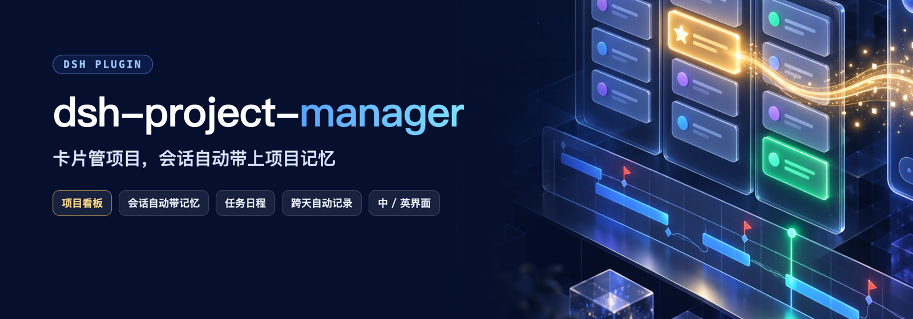
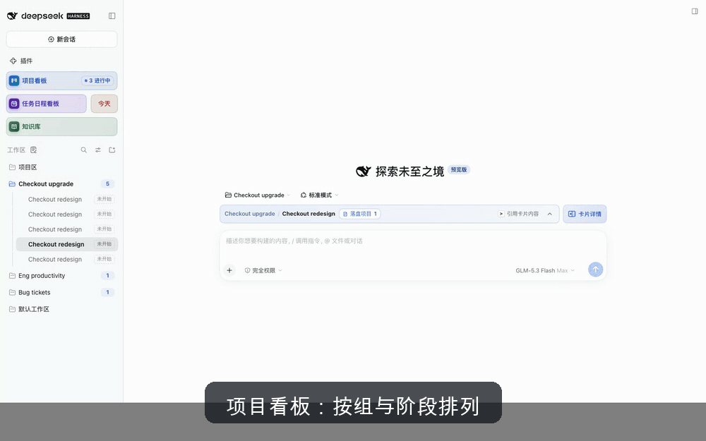
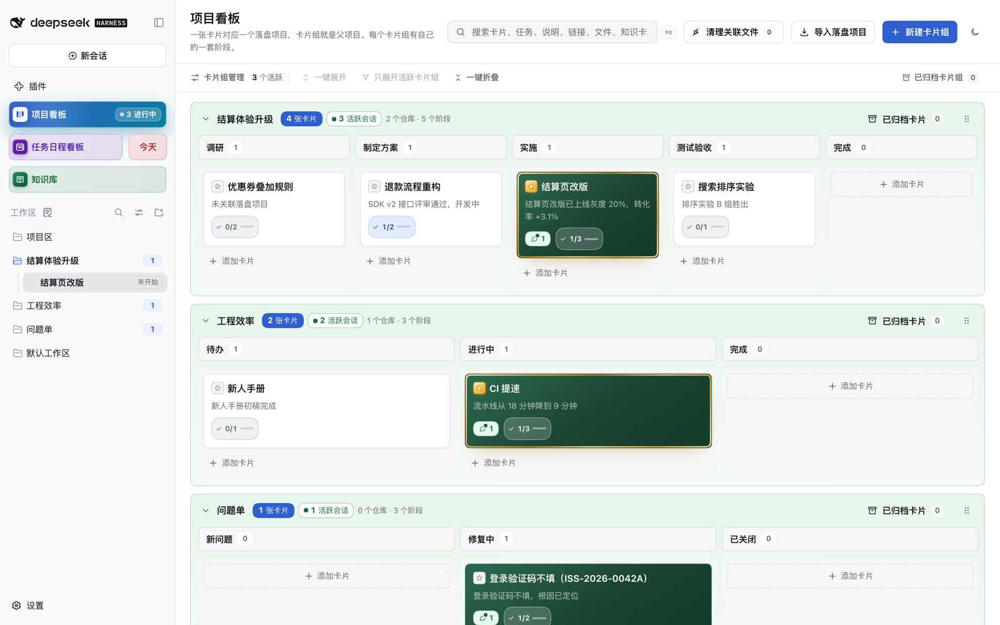
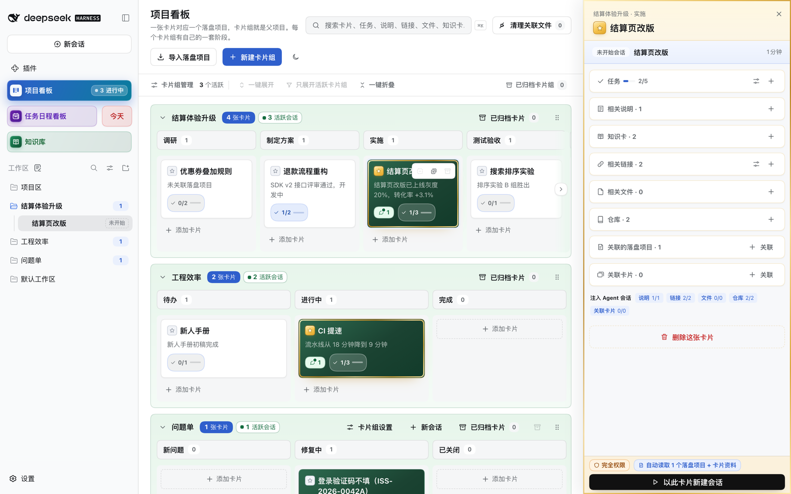
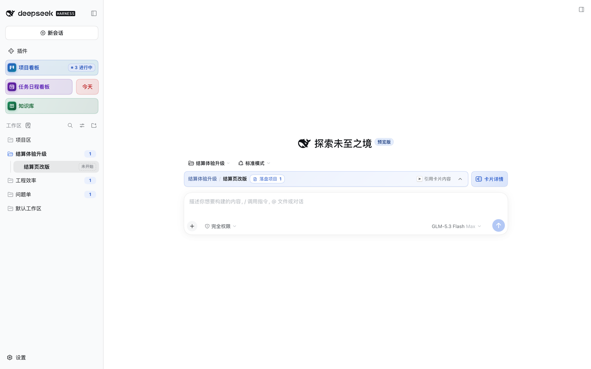
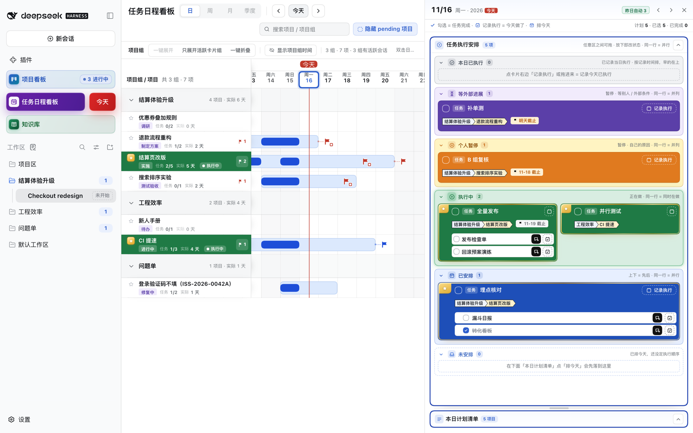
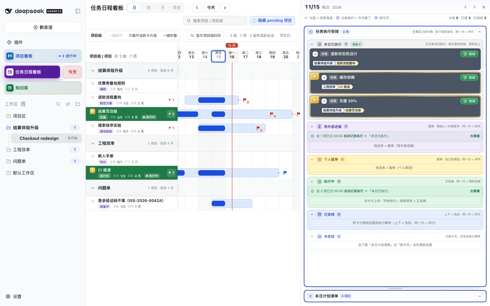
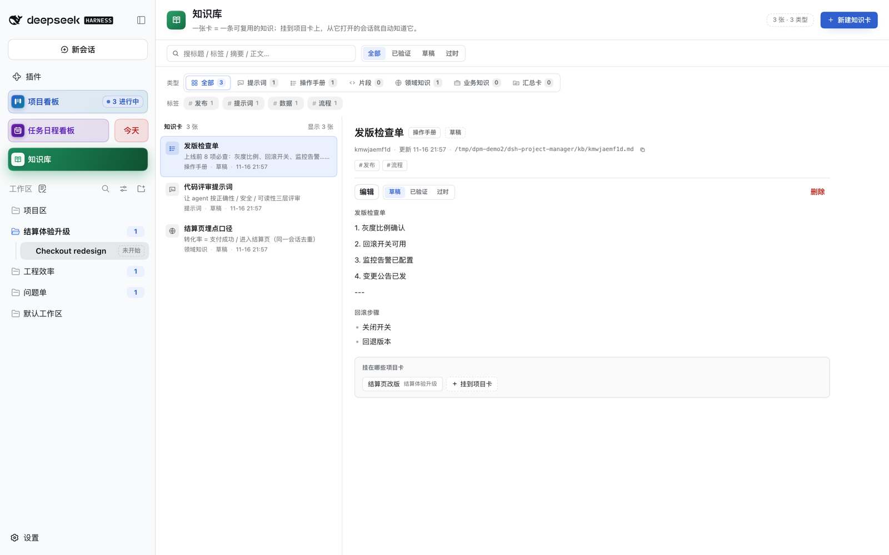
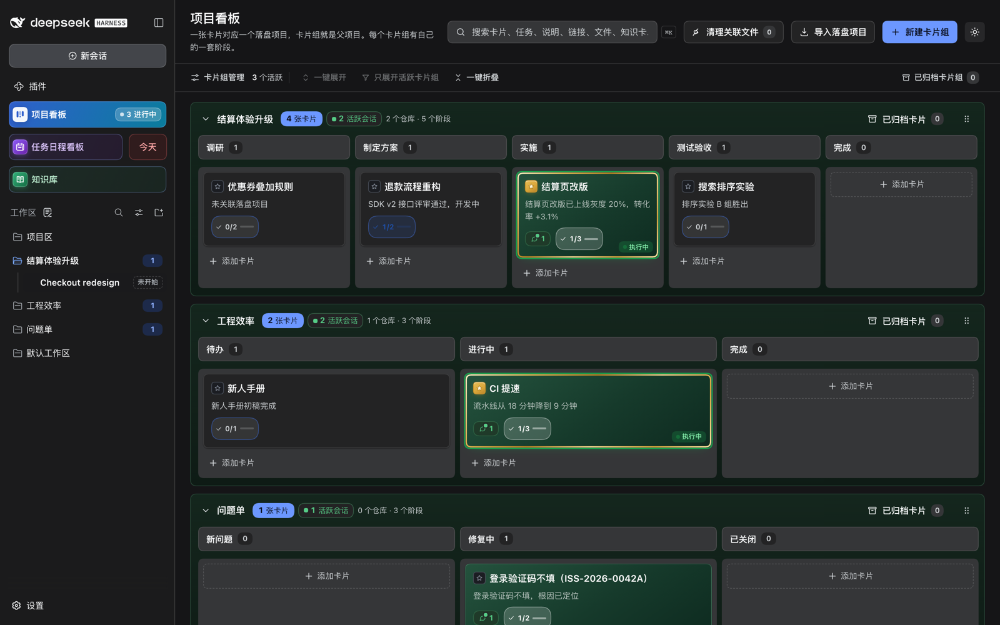

<div align="center">



# dsh-project-manager

**DeepSeek Harness 的项目看板 + 项目记忆。从卡片开会话，AI 第一步就带着项目当前状态。**

<a href="https://www.npmjs.com/package/dsh-project-manager"></a>
<a href="https://www.npmjs.com/package/dsh-project-manager"></a>
<a href="https://github.com/hoyyang/dsh-project-manager/releases"></a>
<a href="https://github.com/hoyyang/dsh-project-manager/stargazers"></a>
<a href="LICENSE"></a>

**简体中文** · [English](README.en.md) · [Русский](README.ru.md) · [Releases](https://github.com/hoyyang/dsh-project-manager/releases) · [更新日志](CHANGELOG.md) · [问题反馈](https://github.com/hoyyang/dsh-project-manager/issues)

</div>

## 安装

```sh
dsh plugin add dsh-project-manager
```

备选：`dsh plugin add github:hoyyang/dsh-project-manager`。安装后重启 dsh，零配置，无需账号或 API Key。

> 需要 dsh web 界面（`dsh web` 或 DSH Desktop）。已在 dsh `0.2.0-rc.2` 实测。项目记忆功能需要 `python3`（Windows 上仅该部分关闭）。

## 亮点

<p align="center"></p>

| | 特性 | 说明 |
|---|---|---|
| 🗂 | **项目看板** | 卡片组 = 父项目，卡片 = 项目；一个搜索框搜标题和卡片里的所有内容 |
| 🧠 | **会话自动加载记忆** | 从卡片开会话，自动注入 `STATE.md` 与 `[必读]` 全文；外部改写后下一步自动同步新版 |
| 🛡 | **一句话落盘防丢事实** | 未读全拒写；新稿漏掉旧稿的 commit、路径、版本号且未声明时，返回 `DROPPED_ANCHORS` 拒写 |
| 📅 | **任务日程 + 今天面板** | 计划、实际、截止一条时间轴；过 00:00 自动把昨天在做的记成「已执行」 |
| ⚡ | **任务 ↔ 会话联动** | 关联会话开始运行，任务或子任务立即进入「执行中」 |
| 📚 | **知识库 + 中英界面** | 可复用知识卡挂到项目上；界面中文 / English 一键切换，不刷新 |

## 功能详解

### 项目看板与卡片详情



- **泳道分组**：每个卡片组是一条独立泳道，阶段支持重命名与调整顺序，拖拽卡片推进阶段。
- **状态感知**：卡片展示会话数与任务进度，有会话正在运行的卡片亮绿框。
- **星标项目**：星标后在看板、详情、甘特图、今天面板同步显示金色徽章。
- **穿透搜索**：一次检索同时匹配卡片标题与内容（任务、子任务、说明、链接、文件、关联知识卡），点击命中片段直达对应条目。



- **卡片资料库**：集中管理任务、说明、知识卡、链接、文件、代码仓库与关联落盘项目，每项资料均可单独开关是否注入会话。

### 会话自动带上项目记忆



- **全文自动注入**：从卡片新建会话，关联的 `STATE.md` 及 `[必读]` 子文档全文自动注入，无需手动触发回忆。
- **跨端版本追踪**：其他会话或外部 CLI（Codex / Claude Code）更新了 STATE，本会话下一步自动接收新版本，同一版本只发一次。
- **信息栏**：输入框上方显示所属卡片和落盘项目；「引用卡片内容」把任务、说明、知识卡一键插进对话；可查看 AI 收到的原文。
- **一句话落盘**：说「落盘项目 XX」写回进展，说「回忆 XX」/「继续 XX」读全再接着做。
- **防丢事实**：只经自带 `ai-memory` 写入（文件锁 + 乐观并发）；没读全不让写，新稿删了旧稿的 commit、路径、版本号又没声明，直接拒写。
- **整理旧账**：重复的落盘项目可合并，按卡片组归档，都能撤销。

### 任务日程与今天面板



- **一条时间轴**：浅蓝 = 计划，深蓝 = 实际（有对话的那天自动记），红旗 = 截止。
- **今天面板**：等外部进展 / 个人暂停 / 执行中 / 已安排 / 未安排五个分区，拖一下就改状态；「排今天」直接进「已安排」。
- **任务跟着会话走**：任务可关联多个会话（同时只有一个活跃）；会话一跑起来，任务立刻进「执行中」。



- **过 00:00 自动记录执行（0.79 新增）**：刚结束那天还在「等外部进展 / 个人暂停 / 执行中」的卡片，自动记一次「已执行」（不算完成）。今天日期旁显示「昨日自动 N」，点它跳到昨天；点卡片上的「自动」只撤这一批，不会再补记。

### 知识库、界面语言与文件清理



- **知识卡**：提示词 / 操作手册 / 片段 / 领域知识 / 业务知识 / 汇总卡六类，带标签和搜索。
- **挂到项目上**：挂了知识卡的项目，开出来的会话自动看得到；也能只引用其中一段（按带标题的分割线切）。
- **界面语言**：设置 → 项目看板 → 界面语言：跟随 DSH / 中文 / English，立刻生效、不刷新；你写的内容不会被翻译。
- **清理关联文件**：按卡片列出落盘项目里的关联文件，筛「无用 / 任务都完成 / 已归档 / 在用 / 已丢失」；删除进废纸篓，可撤销。



## 快速上手

1. 点击侧栏「项目看板」，新建卡片组与卡片。
2. 打开卡片详情，添加任务、说明或代码仓库。
3. 点击「以此卡片新建会话」开始对话。
4. 打开「任务日程看板」→「今天」，把任务拖进对应分区。
5. 阶段性结束时，在会话里发送「落盘项目」。

| 操作 | 结果 |
|---|---|
| 点击「以此卡片新建会话」 | 侧栏「项目区」按卡片组归拢该会话，第一步已注入卡片资料与 `STATE.md` 全文 |
| 会话中发送「落盘项目」 | 经 `ai-memory` 校验后写回 `~/.ai`，漏掉旧稿关键事实则返回 `DROPPED_ANCHORS` 拒写 |
| 外部 CLI 修改了同一份 STATE | 当前会话下一步自动收到新版全文 |
| 关联任务的会话开始运行 | 任务（含子任务）自动移入今天面板「执行中」 |
| 过了 00:00 | 昨天还在做的任务自动记「已执行」，今天显示「昨日自动 N」 |

在项目会话里，agent 能直接改看板（不传 `card` = 本会话的卡片）：

```text
phase_move  {"status":"verify"}
task_manage {"op":"add","text":"补回归用例"}
landfill    {"op":"recall"}
```

此外还提供 `card_manage` 与 `kb_manage` 工具。

## 使用场景

- **长周期项目**：今天落盘，明天开新会话直接接着做。
- **跨仓库需求**：一张卡片挂前端、SDK、基建多个仓库，会话里都能看到。
- **多 CLI 共用记忆**：DSH 与 Codex / Claude Code 读写同一份 `~/.ai`。
- **每日站会**：打开今天面板，看清每个项目在干什么、昨天做了什么。
- **问题单跟进**：一单一卡，「回忆 + 单号」随时找回分析进度。
- **交接**：卡片里的记忆、说明、链接、会话就是交接清单。
- **收拾散落记忆**：同一件事落成了几份，合并成一份，旧名变别名。
- **让 agent 自己推进**：会话里让 agent 推阶段、加任务，看板实时更新。

## 适合 / 不适合

- **适合**：跨天持续推进的项目、多仓库协同工作、在 DSH 与其他 CLI 间共用项目记忆、每日站会进度复盘。
- **不适合**：仅需简单待办清单；需要多人实时在线协作（所有数据保存在本机）。

## 运行效果

- 从卡片开的会话，第一步就收到 `STATE.md` 与 `[必读]` 全文。
- 落盘后 STATE 写在 `~/.ai/projects/<卡片组文件夹>/memory/designs/<名字>/STATE.md`。
- 每次移动、关联、迁移都追加到 `events.jsonl`，可追溯。
- 侧栏「项目区」按卡片组归拢项目会话，带活跃会话数。
- 过 00:00 后，昨天在做的任务出现在「本日已执行」，带「自动」标记。
- 合并后的旧文件夹进 `inbox/retired/`，可撤销还原。

## 与同类对比

| 能力 | dsh-project-manager | 通用看板 / 待办插件 | 纯记忆插件 |
|---|:---:|:---:|:---:|
| 项目看板 + 自定义阶段 | ✅ | ✅ | — |
| 会话自动注入项目记忆 | ✅ 全文 + 版本追踪 | — | 检索召回 |
| 写回时防丢关键事实 | ✅ | — | — |
| 跨 CLI 共用 `~/.ai` | ✅ | — | — |
| 任务 ↔ 会话状态联动 | ✅ | — | — |
| 日程时间轴 + 跨零点自动记 | ✅ | — | — |
| 多人协作 / 云同步 | — | 视插件 | 视插件 |

## 工作原理

- **两处本地数据**：看板在 `<DSH_HOME>/dsh-project-manager/`，项目记忆在 `~/.ai`（和其他 CLI 共用）。
- **按版本注入**：会话第一步注入卡片资料 + `STATE.md` + `[必读]`；文件变了，下一步补发新版。
- **单一写入通道**：记忆只经自带 `ai-memory` 写：先读全、文件锁、乐观并发、锚点比对。
- **宿主侧结算**：会话运行状态驱动任务分区；跨天收口在宿主里做，一天只跑一次。

## 可靠性

- **两处实测**：每版先在隔离的 staging `DSH_HOME` 逐项点击验证，再在真实实例复验；冷启动静态检查全绿才发布。
- **测试**：596 项单元测试 + 9 项 `ai-memory` 测试。
- **失败点名**：`NEED_FULL_READ`、`DROPPED_ANCHORS`、`SPEC_ISSUES` 等错误码说清原因，不静默失败。
- **安全边界**：路由只接受本机回环；不读凭据、不联网、不执行 git；删卡片组只删软链。
- **降级**：dsh 改版对不上页面结构时，侧栏增强自动隐藏，数据不受影响。
- **可撤销**：删除文件进废纸篓、合并落盘项目、跨天自动记录都能撤销。
- **已知限制**：数据只在本机，不做多人协作；Windows 上落盘功能不可用（需要 `python3`）。

## 常见问题

**侧栏为什么没有「项目区」？**
创建第一个项目会话后才会出现；在此之前请从侧栏「项目看板」入口进入。

**怎么确认 AI 实际收到了哪些上下文？**
点击会话输入框上方信息栏里的「查看 AI 收到的原文」。

**落盘被拒绝怎么办？**
按返回的错误码处理：先执行「回忆」完整读取旧稿，或在 `drop` 中显式声明有意移除的内容。

**为什么昨天的任务被自动记了执行？**
0.79 新增的「过 00:00 自动记录执行」。点「昨日自动 N」跳到昨天，点卡片上的「自动」撤销这一批，之后不会再补记。

**怎么把界面切成英文？**
打开「设置 → 项目看板 → 界面语言」，选择 `English`，立即生效。

**为什么「恢复活跃」按钮是灰色的？**
安装 [dsh-manage-sessions](https://github.com/hoyyang/dsh-manage-sessions)。

## 配置

默认零配置即可使用。如需调整，可在对应 profile 的 `cordis.patch.yml` 顶层添加：

```yaml
- id: dsh-project-manager
  config:
    aiRoot: ''                              # 记忆目录，默认 ~/.ai
    landfill: true                          # false = 仅使用看板
    projectSessionMode: danger-full-access  # 或 inherit
```

## 卸载

```sh
dsh plugin --profile web remove dsh-project-manager
```

卸载插件会保留 `<DSH_HOME>/dsh-project-manager/` 与 `~/.ai` 中的全部数据。

## 本地开发

```sh
npm install && npm run build && npm run build:client && npm test
```

## 许可证

[MIT](LICENSE) © hoyyang