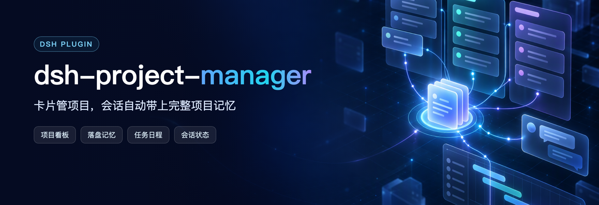
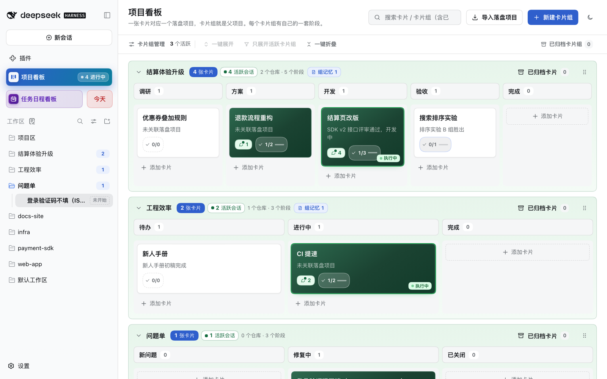
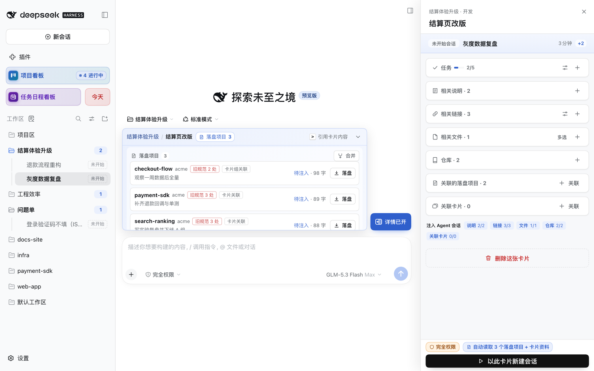
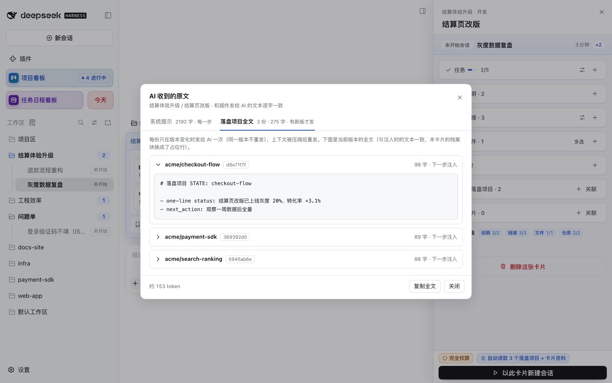
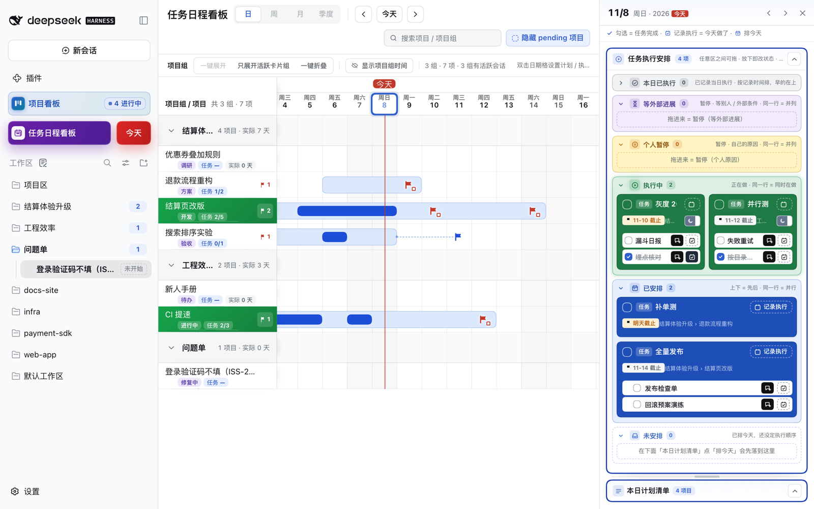
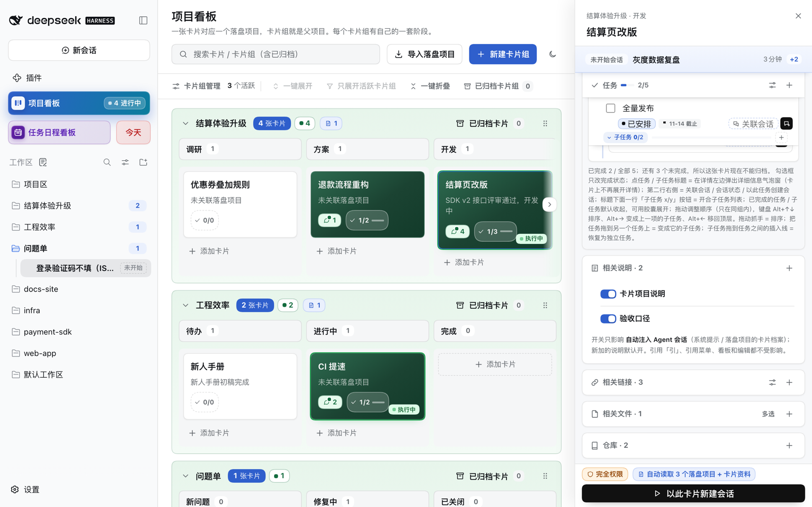
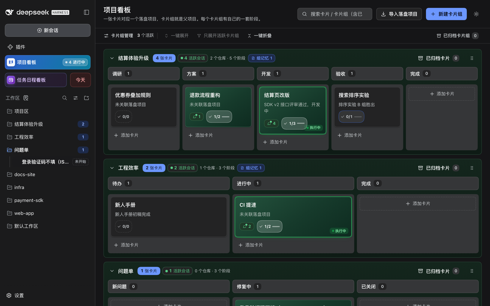

<div align="center">



# dsh-project-manager

**DeepSeek Harness 的项目看板 + 项目记忆。从卡片开会话，AI 第一句话就知道项目做到哪了。**

<a href="https://www.npmjs.com/package/dsh-project-manager"></a>
<a href="https://www.npmjs.com/package/dsh-project-manager"></a>
<a href="https://github.com/hoyyang/dsh-project-manager/releases"></a>
<a href="https://github.com/hoyyang/dsh-project-manager/stargazers"></a>
<a href="LICENSE"></a>

**简体中文** · [English](README.en.md) · [更新日志](CHANGELOG.md) · [问题反馈](https://github.com/hoyyang/dsh-project-manager/issues)

</div>

## 安装

```sh
dsh plugin add dsh-project-manager
```

备选：`dsh plugin add github:hoyyang/dsh-project-manager`。重启 dsh 即可用，**零配置**，无需账号或 API Key。

> 需要 dsh web 界面（`dsh web` 或 DSH Desktop）。实测 dsh `0.2.0-rc.2`、DSH Desktop `2.0.18`。项目记忆需要 `python3`，Windows 上只关这一块。

## 核心功能

| | 功能 | 一句话 |
|---|---|---|
| 🗂 | **项目看板** | 卡片组 = 父项目，卡片 = 项目，阶段自定义，拖动即推进 |
| 🧠 | **会话自动带记忆** | 从卡片开会话，项目 STATE 全文自动注入，别处改了自动补新版 |
| 💾 | **一句话落盘** | 说「落盘项目」写回进展，丢了关键事实直接拒写 |
| 📅 | **任务日程 + 今天面板** | 计划 / 实际 / 截止一条时间轴，今天的任务按状态分区 |
| 🔗 | **任务 ↔ 会话联动** | 会话跑起来，任务自动进「执行中」 |

### 项目看板



- **按项目分组**：每个卡片组一条泳道，阶段名、数量、顺序都能改。
- **状态一眼可见**：卡片显示会话数、任务进度，正在执行的亮绿框。
- **深色主题**：跟随 dsh，一键切换。

### 会话自动带上项目记忆



- **全文注入**：卡片关联的 `STATE.md` 和 `[必读]` 子文档整份放进会话，不用先说「回忆」。
- **始终最新**：其他会话或 Codex / Claude Code 改了 STATE，下一步自动补新版，同一版本只发一次。
- **信息卡**：输入框上方显示本会话属于哪张卡片、带了哪些记忆，可单独落盘。
- **原文可查**：逐字查看 AI 收到的内容和 token 数。



### 一句话落盘，不丢事实

- **触发词**：「落盘项目 XX」写进展，「回忆 XX」/「继续 XX」读全再接着做。
- **防丢事实**：没读全不让写；新稿删掉旧稿里的 commit、路径、版本号又没声明，拒写。
- **并发安全**：只经自带 `ai-memory` 写入（文件锁 + 乐观并发），直接改 `~/.ai` 会被拦截。
- **整理旧账**：同名检测、多份合并、按卡片组归档，都可撤销。

### 任务日程与今天面板



- **一条时间轴**：浅蓝计划、深蓝实际（有对话的那天自动记）、红旗截止。
- **今天面板**：执行中 / 等外部 / 个人暂停 / 已安排 / 未安排分区，拖动改状态。
- **会话状态汇总**：没拆任务的项目卡汇总自己所有会话的状态。

### 卡片详情



- **任务与子任务**：截止日、排今天、关联会话、拖动改层级。
- **卡片资料**：说明、链接、文件、仓库都注入会话，每条可单独开关。
- **一键开会话**：仓库软链到 `repos/<仓库>/`，仓库自己的 `AGENTS.md` 照常加载。

## 快速上手

1. 点击侧栏「项目看板」，再点击「新建卡片组」，输入组名后回车。
2. 点击阶段底部「添加卡片」，输入标题后回车。
3. 打开卡片，在「仓库」里添加你的代码仓库。
4. 点击「以此卡片新建会话」，开始对话。
5. 告一段落时，在会话里输入「落盘项目」。

| 操作 | 结果 |
|---|---|
| 以此卡片新建会话 | 会话出现在侧栏「项目区」，已带上卡片资料和项目记忆 |
| 会话里说「落盘项目」 | STATE 按规范写回，回读校验通过，信息卡提示「落盘完成」 |
| 新稿删了旧 commit 号 | 写入被拒，返回 `DROPPED_ANCHORS` 并列出缺了哪些 |
| 另一个 CLI 改了 STATE | 本会话下一步收到新版全文 |
| 任务关联的会话开始运行 | 今天面板里这项自动移到「执行中」 |
| 拖动卡片到别的阶段 | 卡片换阶段，`events.jsonl` 记一条 move |

在项目会话里让 agent 改看板（不传 `card` = 本会话的卡片）：

```text
phase_move  { "status": "verify" }               → {"ok":true,"event":{"kind":"move","to":"验收"}}
task_manage { "op": "add", "text": "补回归用例" } → {"ok":true,"tasks":[…,{"text":"补回归用例","done":false}]}
landfill    { "op": "recall" }                   → 分段读 STATE + [必读]，直到 complete:true
```

## 使用场景

- **长周期项目**：今天落盘，明天开新会话直接接着做。
- **多 CLI 共用记忆**：DSH 与 Codex / Claude Code 读写同一份 `~/.ai`。
- **跨仓库需求**：一张卡片挂前端、SDK、基建多个仓库。
- **每日站会**：打开今天面板，看清每个项目和会话在干什么。
- **问题单跟进**：一单一卡，「回忆 + 单号」随时找回分析进度。
- **交接**：卡片里的记忆、说明、链接、会话就是交接清单。
- **收拾散落记忆**：同一件事落成了几份，合并成一份，旧名变别名。
- **让 agent 自己推进**：会话里让 agent 推阶段、勾子任务，看板实时更新。

## 适合 / 不适合

- **适合**：要隔几天反复接着做的项目、跨多个仓库的需求、DSH 与其他 CLI 共用一份项目记忆。
- **不适合**：只想要通用待办清单；需要多人在线协作（数据只在本机）。

## 运行效果

- 从卡片开的会话，第一步就收到 STATE 与 `[必读]` 全文。
- 落盘后 STATE 位于 `~/.ai/projects/<卡片组文件夹>/memory/designs/<名字>/STATE.md`。
- 每次移动、关联、迁移都追加到 `events.jsonl`，可追溯。
- 侧栏「项目区」按卡片组归拢项目会话，带活跃会话数。
- 合并后旧文件夹进 `inbox/retired/`，可撤销还原。
- 信息卡实时显示落盘结局：完成、已停止或出错，并给「重新落盘」。



## 与同类对比

| | dsh-project-manager | 通用看板 / 待办插件 | 纯记忆插件 |
|---|:---:|:---:|:---:|
| 项目看板 + 阶段 | ✅ | ✅ | — |
| 会话自动注入项目记忆 | ✅ 全文 + 版本追踪 | — | 检索召回 |
| 写回防丢事实 | ✅ | — | — |
| 多 CLI 共用 `~/.ai` | ✅ | — | — |
| 任务 ↔ 会话状态联动 | ✅ | — | — |
| 多人协作 / 云同步 | — | 视插件 | 视插件 |

## 可靠性

- **隔离验收**：每版先在独立 staging DSH_HOME 逐项点击验证，冷启动静态检测全绿才发布。
- **测试**：256 项单元测试 + 9 项 `ai-memory` 测试。
- **失败点名**：`NEED_FULL_READ`、`DROPPED_ANCHORS`、`SPEC_ISSUES` 等错误码说清原因，不静默失败。
- **安全边界**：路由只接受本机回环；不读凭据、不联网、不执行 git；删卡片组只删软链。
- **降级**：dsh 改版对不上页面结构时，侧栏增强自动隐藏，数据不受影响。

## 常见问题

- **侧栏没有「项目区」？** 新建第一个项目会话后出现，之前用「项目看板」按钮进入。
- **怎么知道 AI 收到了什么？** 信息卡点「查看 AI 收到的原文」。
- **落盘被拒？** 按错误码处理：先「回忆」读全，或在 `drop` 里声明有意删除的内容。
- **「恢复活跃」是灰的？** 安装 [dsh-manage-sessions](https://github.com/hoyyang/dsh-manage-sessions)。

## 配置

零配置可用。需要时在 profile 的 `cordis.patch.yml` 加顶层条目：

```yaml
- id: dsh-project-manager
  config:
    aiRoot: ''                              # 记忆目录，缺省 ~/.ai
    landfill: true                          # false = 只用看板
    projectSessionMode: danger-full-access  # 或 inherit
```

## 卸载

```sh
dsh plugin --profile web remove dsh-project-manager
```

看板数据（`<DSH_HOME>/dsh-project-manager/`）和 `~/.ai` 不会被删除。

## 开发

```sh
npm install && npm run build && npm run build:client && npm test
```

## 许可证

[MIT](LICENSE) © hoyyang
