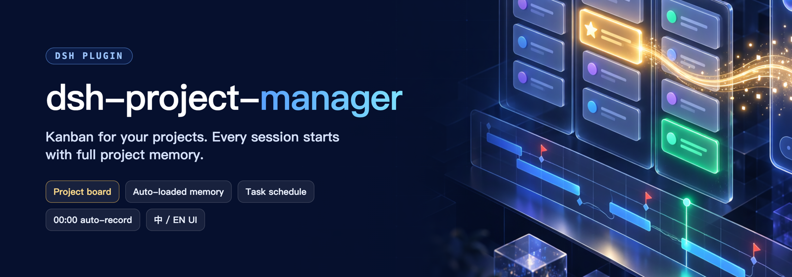
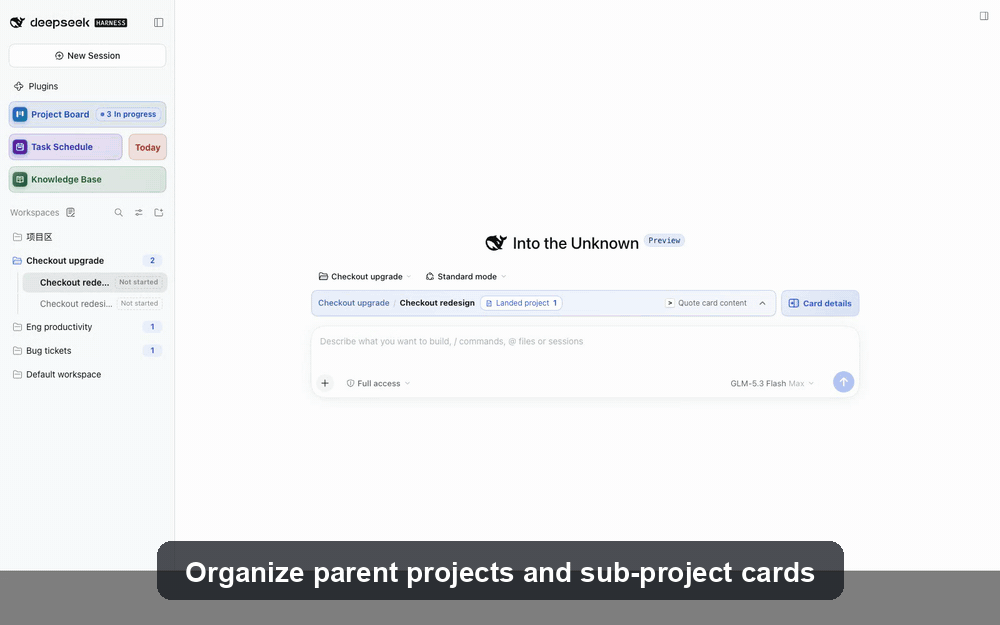
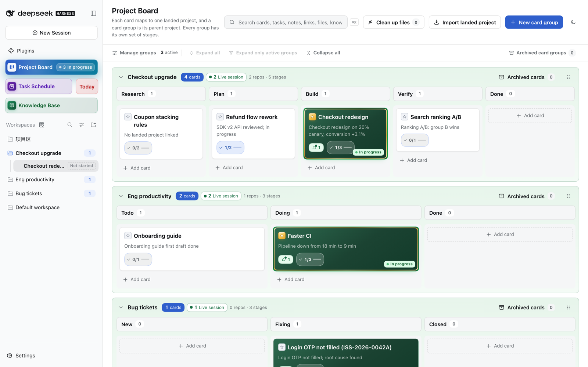
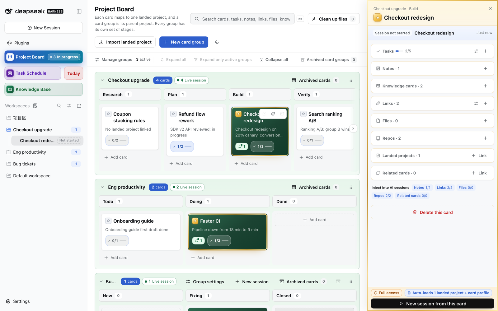
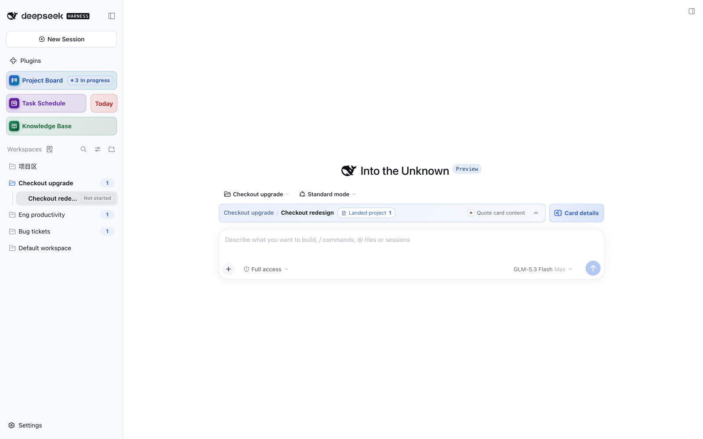
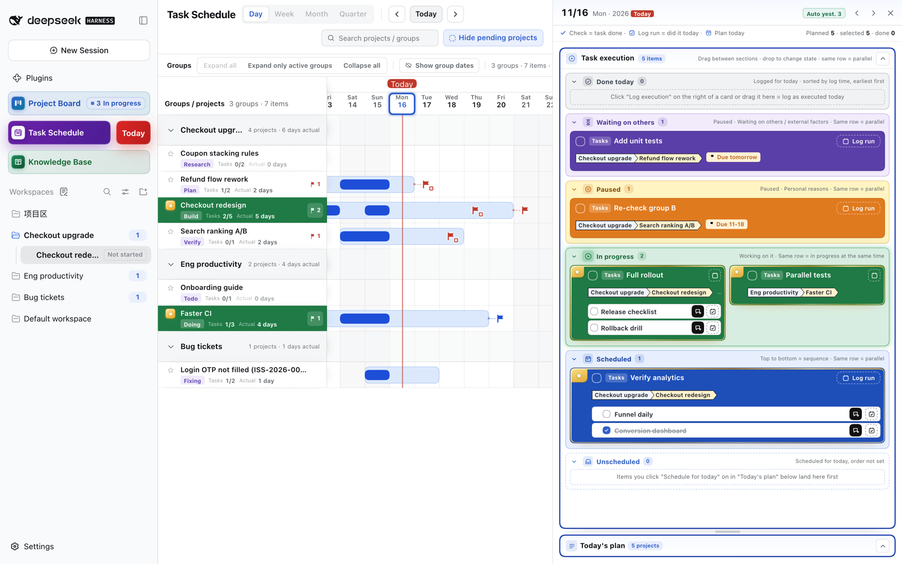
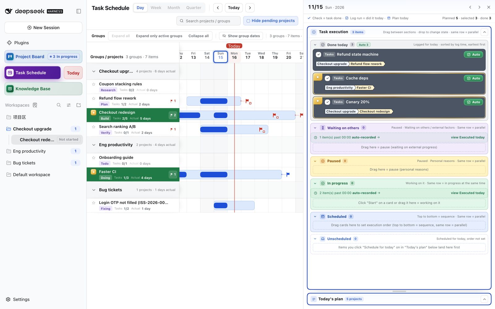
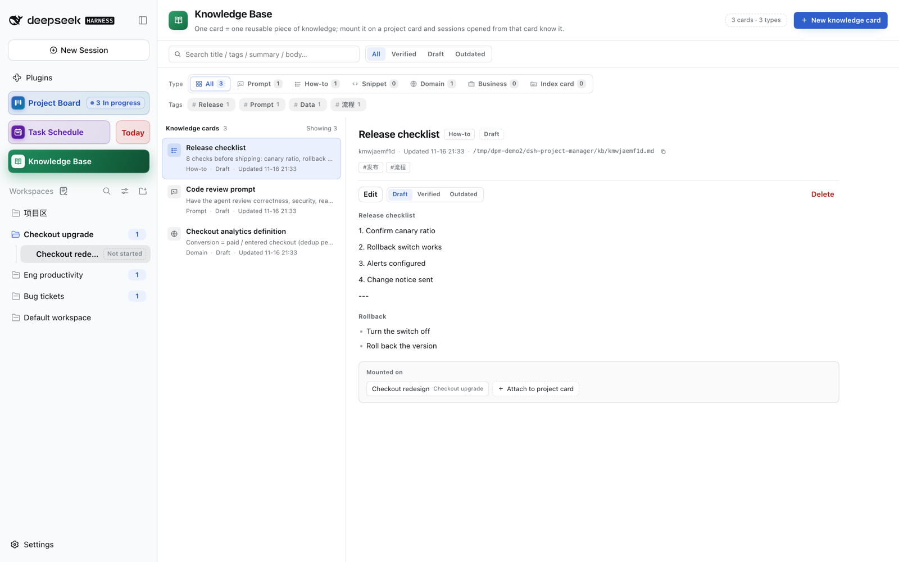

<div align="center">



# dsh-project-manager

**Доска проекта и постоянная память проекта для DeepSeek Harness. Откройте сессию из карточки — и с первого же шага ИИ получит полное состояние проекта.**

<a href="https://www.npmjs.com/package/dsh-project-manager"></a>
<a href="https://www.npmjs.com/package/dsh-project-manager"></a>
<a href="https://github.com/hoyyang/dsh-project-manager/releases"></a>
<a href="https://github.com/hoyyang/dsh-project-manager/stargazers"></a>
<a href="LICENSE"></a>

**Русский** · [English](README.en.md) · [简体中文](README.md) · [Релизы](https://github.com/hoyyang/dsh-project-manager/releases) · [История изменений](CHANGELOG.md) · [Проблемы](https://github.com/hoyyang/dsh-project-manager/issues)

</div>

## Установка

```sh
dsh plugin add dsh-project-manager
```

Альтернативный вариант: `dsh plugin add github:hoyyang/dsh-project-manager`. После установки перезапустите dsh. Не требует настройки, учётной записи или API-ключа.

> Требуется веб-интерфейс dsh (`dsh web` или DSH Desktop). Протестировано на dsh `0.2.0-rc.2`. Для работы памяти проекта необходим `python3` (в Windows отключается только память проекта).

## Возможности

<p align="center"></p>

| | Функция | Описание |
|---|---|---|
| 🗂 | **Доска проекта** | Группа карточек = родительский проект, карточка = проект; единая строка поиска ищет по заголовкам и всему содержимому внутри карточек |
| 🧠 | **Автозагрузка памяти проекта** | Сессии, открытые из карточки, автоматически получают полный `STATE.md` и обязательные к прочтению документы, синхронизируя обновления между разными CLI |
| 🛡 | **Защищённая запись памяти** | Отклоняет запись без предварительного полного чтения или при необъявленном исчезновении коммитов, путей или версий (`DROPPED_ANCHORS`) |
| 📅 | **Расписание + панель «Сегодня»** | План, факт и дедлайны на единой шкале времени; после 00:00 незавершённая за вчера работа автоматически фиксируется в журнале |
| ⚡ | **Синхронизация задача ↔ сессия** | Когда связанная сессия переходит в состояние выполнения, задача перемещается в **В работе** |
| 📚 | **База знаний + интерфейс EN/中文** | Переиспользуемые карточки знаний, прикрепляемые к проектам; мгновенное переключение языка интерфейса |

## Функции

### Доска проекта



- **Группы-дорожки (Swimlanes)**: каждая группа карточек представляет собой дорожку с настраиваемыми этапами (их можно переименовывать и менять местами); перетаскивайте карточки между этапами для отслеживания прогресса.
- **Индикаторы активности в реальном времени**: на карточках отображается количество сессий и прогресс по задачам; карточки с активной сессией подсвечиваются зелёным.
- **Избранные проекты**: отметьте любую карточку звёздочкой, чтобы золотой значок отображался на доске, в боковой панели деталей, на диаграмме Ганта в расписании и на панели «Сегодня».
- **Глубокий поиск**: один запрос ищет по заголовкам карточек и внутреннему содержимому (задачи, подзадачи, заметки, ссылки, файлы, прикреплённые карточки знаний) с показом фрагментов совпадений и прямым переходом к нужному элементу.



- **Детали карточки**: задачи, заметки, карточки знаний, ссылки, файлы, репозитории и связанный проект на диске собраны в одной выдвижной панели; для каждого элемента можно включить или отключить передачу в сессию.

### Сессии стартуют с памятью проекта



- **Полнотекстовая инъекция**: сессии, запущенные из карточки, на первом же шаге автоматически получают полный текст связанного `STATE.md` и его вложенных документов с пометкой `[必读]` (обязательно к прочтению).
- **Меж-CLI отслеживание версий**: если другая сессия или внешний CLI (Codex / Claude Code) изменит `STATE.md`, на следующем шаге ваша сессия получит обновлённую версию (каждая версия отправляется один раз).
- **Информационная панель**: расположена над полем ввода — показывает карточку и проект на диске; кнопка **Цитировать содержимое карточки** вставляет задачи, заметки или карточки знаний прямо в чат; также можно просмотреть исходный текст, который получил ИИ.
- **Сохранение на диск и восстановление одной фразой**: напишите `落盘项目 <name>` (сохранить проект на диск), чтобы записать прогресс, или `回忆 <name>` / `继续 <name>` (вспомнить / продолжить), чтобы прочитать состояние и продолжить работу. Триггерные команды намеренно оставлены на китайском языке.
- **Защита при записи**: все операции записи проходят через встроенный инструмент `ai-memory` (файловые блокировки + оптимистичная конкурентность). Перед записью ИИ обязан прочитать полное состояние; если в новом черновике без явного указания пропали ID коммитов, пути к файлам или номера версий, запись отклоняется с кодом `DROPPED_ANCHORS`.
- **Наведение порядка**: объединение дублирующихся проектов на диске и архивация по группам карточек — все действия обратимы.

### Расписание задач и панель «Сегодня»



- **Единая шкала времени**: плановые даты (голубой), фактические дни активности (тёмно-синий, записываются автоматически в дни, когда велся диалог) и флажки дедлайнов (красный) на одной диаграмме Ганта.
- **Панель «Сегодня»**: зоны **Ожидание других / На паузе / В работе / Запланировано / Не запланировано**; перетаскивайте элементы для смены статуса. Кнопка **Запланировать на сегодня** сразу отправляет задачу в «Запланировано».
- **Задачи следуют за сессиями**: к задаче можно привязать несколько сессий (одна активная). Как только связанная сессия начинает выполняться, задача или подзадача сразу же переходит в зону **В работе**.



- **Автофиксация в 00:00 (новое в 0.79)**: карточки, оставшиеся на конец дня в статусах «Ожидание других» / «На паузе» / «В работе», автоматически записываются как выполнявшиеся в этот день (но не помечаются завершёнными). Значок рядом с сегодняшней датой позволяет перейти ко вчерашнему дню; нажмите **Auto** на карточке, чтобы отменить эту пакетную запись — повторно она добавлена не будет.

### База знаний, язык интерфейса и очистка файлов



- **Карточки знаний**: промпты, инструкции (how-to), фрагменты кода, предметные и бизнес-знания, сводные карточки — с тегами и поиском.
- **Прикрепление или цитирование**: прикрепите карточку знаний к проекту, чтобы она была видна во всех его сессиях; либо процитируйте всю карточку целиком или только один раздел, отделённый именованным разделителем.
- **Язык интерфейса**: Настройки → Доска проекта → Язык интерфейса: как в DSH / 中文 / English. Переключается мгновенно без перезагрузки страницы; ваш собственный контент никогда не переводится.
- **Очистка файлов**: выводит список файлов, привязанных к карточкам в проектах на диске, с группировкой по карточкам; есть фильтры: ненужные / все задачи выполнены / в архиве / используются / отсутствуют. Удалённые файлы перемещаются в Корзину с возможностью восстановления.

## Быстрый старт

1. Нажмите **Доска проекта** на боковой панели, затем **Новая группа карточек** и **Добавить карточку**.
2. Откройте боковую панель карточки, чтобы добавить задачи, заметки или репозитории.
3. Нажмите **Новая сессия из этой карточки**.
4. Откройте **Расписание задач** → **Сегодня** и перетащите задачи в нужные зоны.
5. Достигнув важного этапа, введите `落盘项目` в сессии, чтобы сохранить состояние на диск.
6. Откройте **Базу знаний**, создайте карточку знаний и прикрепите её к проекту в деталях карточки.
7. Нажмите **Цитировать содержимое карточки** над полем ввода, чтобы вставить заметку или раздел карточки знаний прямо в запрос.
8. Введите запрос в поиск на **Доске проекта** и нажмите на совпадение, чтобы перейти к нужному элементу внутри карточки.
9. Нажмите звёздочку на карточке, чтобы отметить её золотым значком на доске, в расписании и на панели «Сегодня».
10. Откройте очистку файлов, отфильтруйте по «Не используются» или «Все задачи выполнены» и перенесите файлы в Корзину — отмена доступна.

| Действие | Результат |
|---|---|
| Нажать **Новая сессия из этой карточки** | Сессия появляется в разделе **Область проектов** боковой панели с уже загруженными материалами карточки и `STATE.md` |
| Сохранить состояние проекта на диск в чате | Данные проверяются и записываются в `~/.ai` через `ai-memory`; при пропуске ключевых фактов запись отклоняется с `DROPPED_ANCHORS` |
| Другой CLI обновляет `STATE.md` | На следующем шаге ваша активная сессия автоматически получает новую версию |
| Связанная с задачей сессия начинает работу | Задача перемещается в зону **В работе** на панели «Сегодня» |
| Часы переходят отметку `00:00` | Вчерашние активные задачи фиксируются как выполнявшиеся; значок рядом с сегодняшним днём ведёт к ним |
| Нажать **Цитировать содержимое карточки** и выбрать раздел карточки знаний | Выбранный раздел вставляется прямо в поле ввода диалога |
| Ввести запрос в поиск на доске и нажать на совпадение | Открываются детали карточки и прокручиваются к нужной задаче, подзадаче, заметке или карточке знаний |
| Выбрать привязанные файлы архивных проектов в очистке и удалить их | Файлы переносятся в Корзину, а внизу появляется кнопка «Отменить» |

Внутри проектной сессии агент может управлять доской напрямую (если параметр `card` не указан, используется карточка текущей сессии):

```text
phase_move  {"status":"verify"}
task_manage {"op":"add","text":"Add regression tests"}
landfill    {"op":"recall"}
```

Также доступны инструменты `card_manage` и `kb_manage`.

```text
card_manage {"op":"update","star":true}
```
```text
kb_manage   {"op":"list","tag":"prompt"}
```
```text
task_manage {"op":"check","num":"2.1","done":true}
```

## Сценарии использования

- **Долгосрочные проекты**: сохраните состояние сегодня, а завтра откройте новую сессию и продолжите ровно с того места, где остановились.
- **Работа с несколькими репозиториями**: одна карточка объединяет репозитории фронтенда, SDK и инфраструктуры — сессия видит их все.
- **Единая память для разных CLI**: DSH, Codex и Claude Code читают и пишут в один и тот же каталог `~/.ai`.
- **Ежедневные стендапы**: панель «Сегодня» наглядно показывает, что происходит в каждом проекте сейчас и что было сделано вчера.
- **Тикеты по багам**: одна карточка на тикет; вызывайте память по ID тикета, чтобы мгновенно вернуть контекст расследования.
- **Передача дел (Handover)**: память карточки, заметки, ссылки и сессии формируют готовый пакет для передачи проекта.
- **Наведение порядка в разрозненной памяти**: несколько копий одного проекта сливаются в одну, а старые имена становятся псевдонимами (алиасами).
- **Управление через агента**: попросите агента передвинуть этап или добавить задачи — доска обновится в реальном времени.

- **Повторное использование промптов и регламентов**: держите стандарты кода или инструкции по разбору инцидентов в карточках знаний и прикрепляйте их к нескольким карточкам.
- **Уборка устаревших артефактов**: после завершения проекта отфильтруйте привязанные файлы по «Все задачи выполнены» или «В архиве» и перенесите их в Корзину.

## Когда подходит / когда не подходит

- **Подходит**: для многодневных проектов, к которым вы регулярно возвращаетесь, работы с несколькими репозиториями, обмена памятью проекта между DSH и другими CLI, а также для ежедневного обзора задач.
- **Не подходит**: для простых изолированных списков дел (todo) или совместной работы нескольких пользователей в реальном времени (все данные хранятся локально на вашей машине).

## Результаты работы

- Сессии, открытые из карточки, получают `STATE.md` и обязательные документы уже на первом шаге.
- Сохранённое состояние записывается по пути `~/.ai/projects/<папка группы>/memory/designs/<имя>/STATE.md`.
- Каждое перемещение, привязка и миграция дописываются в журнал `events.jsonl`.
- Раздел **Область проектов** на боковой панели группирует проектные сессии по группам карточек со счётчиками в реальном времени.
- После 00:00 вчерашние активные задачи отображаются в блоке **Выполнено за день** с меткой **Auto**.
- Объединённые папки перемещаются в `inbox/retired/`, откуда их можно восстановить.

- Прикреплённые карточки знаний автоматически передаются в новые сессии; если выключить передачу одного элемента, он перестаёт отправляться со следующего шага.
- После смены языка интерфейса в «Настройки → Доска проекта» (как в DSH / 中文 / English / Русский) подписи доски и панелей меняются сразу, без перезагрузки страницы.

## Сравнение

| | dsh-project-manager | Обычные канбан / todo-плагины | Плагины только для памяти |
|---|:---:|:---:|:---:|
| Доска проекта + настраиваемые этапы | ✅ | ✅ | — |
| Автоинъекция памяти проекта в сессии | ✅ Полный текст + отслеживание версий | — | Только поиск по запросу |
| Защита записи от потери фактов | ✅ | — | — |
| Общий каталог `~/.ai` для разных CLI | ✅ | — | — |
| Синхронизация статусов задача ↔ сессия | ✅ | — | — |
| Ежедневное расписание + автозакрытие дня | ✅ | — | — |
| Многопользовательский режим / облачная синхронизация | — | Зависит от решения | Зависит от решения |

## Как это работает

- **Два локальных хранилища**: данные доски хранятся в `<DSH_HOME>/dsh-project-manager/`, а память проекта — в `~/.ai`, доступном другим CLI.
- **Версионированная инъекция**: на первом шаге передаются материалы карточки + `STATE.md` + обязательные документы; при изменении файла следующий шаг получает новую версию.
- **Единый контур записи**: память записывается исключительно через встроенный `ai-memory` — предварительное полное чтение, файловая блокировка, оптимистичная конкурентность и проверка якорей.
- **Обработка на стороне хоста**: состояние сессии управляет зонами задач; закрытие дня в 00:00 выполняется хост-процессом один раз в сутки.

## Надёжность

- **Двойное тестирование**: каждый релиз проходит ручное тестирование кликами в изолированном тестовом `DSH_HOME`, а затем на реальном экземпляре; статические проверки холодного старта обязательны к прохождению.
- **Тесты**: 596 модульных (unit) тестов + 9 тестов `ai-memory`.
- **Явная диагностика сбоев**: коды ошибок вроде `NEED_FULL_READ`, `DROPPED_ANCHORS`, `SPEC_ISSUES` точно указывают на причину отказа.
- **Безопасность по умолчанию**: маршруты доступны только через loopback; нет чтения учётных данных, сетевых вызовов или операций с git; удаление группы карточек удаляет только символьные ссылки.
- **Мягкая деградация**: если обновление dsh изменит структуру страницы, дополнения боковой панели просто скроются, а данные останутся нетронутыми.
- **Обратимость действий**: удаляемые файлы помещаются в Корзину; слияния проектов и автофиксацию в 00:00 можно отменить.
- **Известные ограничения**: данные хранятся только на текущей машине (нет синхронизации между пользователями); сохранение памяти на диск недоступно в Windows (требуется `python3`).

## Частые вопросы (FAQ)

**В боковой панели нет раздела «Область проектов».**
Он появится после запуска вашей первой проектной сессии. До этого используйте пункт **Доска проекта**.

**Как посмотреть, что именно получил ИИ?**
В информационной панели над полем ввода нажмите **Просмотреть исходный текст, полученный ИИ**.

**Сохранение памяти на диск было отклонено.**
Следуйте коду ошибки: сначала полностью прочитайте состояние (`NEED_FULL_READ`) или явно перечислите намеренно удаляемые элементы в параметре `drop` (`DROPPED_ANCHORS`).

**Почему вчерашние задачи записались автоматически?**
Это функция автофиксации в 00:00, появившаяся в версии 0.79. Перейдите ко вчерашнему дню и нажмите **Auto** на карточке, чтобы отменить пакетную запись — повторно она не появится.

**Как переключить интерфейс на английский язык?**
Настройки → Доска проекта → Язык интерфейса → English.

**Кнопка «Восстановить» неактивна (серая).**
Установите плагин [dsh-manage-sessions](https://github.com/hoyyang/dsh-manage-sessions).

## Конфигурация

По умолчанию настройка не требуется. Для изменения параметров добавьте запись верхнего уровня в файл `cordis.patch.yml` вашего профиля:

```yaml
- id: dsh-project-manager
  config:
    aiRoot: ''                              # каталог памяти, по умолчанию ~/.ai
    landfill: true                          # false = только доска без памяти на диске
    projectSessionMode: danger-full-access  # или inherit
```

## Удаление

```sh
dsh plugin --profile web remove dsh-project-manager
```

При удалении плагина каталоги `<DSH_HOME>/dsh-project-manager/` и `~/.ai` сохраняются нетронутыми.

## Локальная разработка

```sh
npm install && npm run build && npm run build:client && npm test
```

## Лицензия

[MIT](LICENSE) © hoyyang